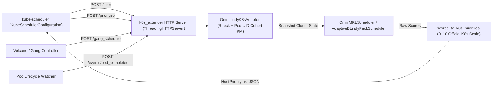

# `Omni-Lindy` / `Omni-MRL` (v11.1): 시공간 단편화, 이기종 자원 잠식, 멀티노드 토폴로지, 양방향 위험률을 통합하는 무예측 AI 클러스터 스케줄러

> [English Version](./omni_lindy_paper_en.md)

> **요약 (Abstract)**
>
> 대규모 AI/GPU 클러스터에서는 분수 GPU 추론 파드(0.1-0.5 GPU)와 다중 GPU·멀티노드 분산 학습 작업(1-64 GPU)이 동적으로 공존하면서, 단순한 공간 잔여(Spatial Fragmentation)뿐 아니라 **시간적 수명 격차에 의한 시공간 단편화**가 병목을 유발한다. 기존 공간 패커 `FGD` (USENIX ATC '23)는 동적 환경에서 오히려 노드를 분산시키는 **"음수 기울기 분산 함정"**에 빠지며, Google `LAVA`/`NILAS` (MLSys '25)나 Alibaba `DVLA` (OSDI) 같은 최신 수명 인지 연구들은 별도의 ML 예측기나 라이브 마이그레이션(또는 VM 단위 재예측)을 전제로 한다.
>
> 본 논문은 미래 작업 수명 예측기(Zero-ML)와 실행 중 마이그레이션(Zero-Migration) 없이 **완전 무예측(Strict Non-Clairvoyant)** 제약 하에서 진화적 수식 발견, 온라인 휴리스틱 이중 게이트, 실클러스터 확장, 경험적 잔여수명(MRL) 동기화 종료 원리를 통합한 **`Omni-Lindy` (v7.0)** 및 적대적 리뷰 교정·프로덕션 규약 정합화를 반영한 완성형 **`Omni-MRL` (v11.1)** 스케줄러를 제안한다. 제안 프레임워크는 (1) 8개 고정 물리 상수로 구성된 **`B-LindyPack`** 이산 경계 보호·공간 스코어러, (2) 온라인 로그 상관 $\hat{\rho}_t$와 갱신이론 검사 역설(Inspection Paradox) 근사 변동계수 $\hat{c}_t$ 기반 **시간 단위 불변 양방향 위험률 게이트($\alpha, \gamma_{\text{DFR}}, \gamma_{\text{IFR}}$)**, (3) 저분산·고정에폭 IFR 환경에서 **동일 진입 코호트(Same-Entry Cohort) `Kaplan-Meier` 길이편향 완화 추정** 및 $u_{\text{cut}}$ 좌·우극한 $C^0$·비음수 위험률($\hat{R}'(u)\ge -1$)을 보장하는 매끄러운 `tanh` 꼬리·$\text{CV}$ 방향 $C^1$ MRL 모델로 호스트 연장 비용 $\Delta \tilde{T}$를 추정해 곧 비워질 노드를 회수하는 동기화 종료 메커니즘, (4) 이기종 `Max-of-N` 린디 감쇠·유계 `Live Spec-Scarcity`·`Rack-Preservation` & `Tightest-Fit Rack` 계층을 통합한다.
>
> **Alibaba PAI 2023 (1,213 노드, 6,212 물리 GPU)**, **SenseTime Helios (336만 행, 최대 64G 멀티노드)**, **Alibaba GPU-v2026 (40,522,321건)** 및 **AcmeTrace Kalos (19,907건)** 등 4개 공개 실트레이스 감사와 **Phase 11 완전 신규 Lockbox 30-시드(`[20011 + 103i]`) · 확장 Dev 그리드($w \in [0.05, 4.0]$) · 편향 분리 오차 모델 · Holm 96개 가설 보정 · 독립 실트레이스** 평가 결과:
> 1. **완전 신규 Lockbox 30-시드 공정 팩토리얼 (`FirstFit`/`NILAS-L2` 복원, Pareto 프론티어)**: 파라미터 동결 후 완전히 새로운 30개 시드에서 `Omni-MRL-v11`은 **`IFR_Uniform`**(`v7` 대비 Blk `+12.46%`, BF `+52.02%`, $p_{\text{holm96}} \le 2.57\times 10^{-4}$; `NILAS-BPack`과는 BF `+1.18%` 비유의 / Blk `-3.09%`, $p_{\text{holm96}}=0.0114$), **`IFR_Weibull_k2`**(전 비교군 Blocking 1위 `7.132%`, `v7` 대비 `+6.10%` Blk·`+11.71%` BF, $p_{\text{holm96}}\le 0.0150$; 단 BF Wait은 `FirstFit 0.459h < v11 0.513h`), **`W4_Memoryless_OOD`**(`L2Norm`/`BPack` 계열 대비 Blk `+6.97% - +8.32%`, $p_{\text{holm96}}\le 0.0122$), **`W2_Regime_Shift`**(`NILAS-BPack` 대비 BF `+4.57%`, $p_{\text{holm96}}=1.20\times 10^{-3}$)에 걸쳐 **6개 중 5개 워크로드(`W2` 제외)에서 Blk–BF 파레토 프론티어에 진입**하였다. 순수 메커니즘 분리 Ablation(`Omni-MRL-NoPristineRelax`)으로 MRL 회수 항 단독 기여(`+13.94%`/`+7.32%` Blk, $p_W \le 7.33\times 10^{-6}$)를 입증하고, **`W1_PAI_Mixed`**(`L2Norm 3.806%` vs `v11 3.699%`, $p_{\text{holm96}}=1.0$) 및 **`W3`**(`LAVA-BPack 0.894%` vs `v11 0.956%`) 결과를 포함한 유불리를 100% 공개한다.
> 2. **편향 분리(`bias_corrected`) Dual-Oracle 교차점 (`IFR_Uniform`)**: 평균 편향을 제거한 로그노멀 오차($\mathbb{E}[\exp(N(-\sigma^2/2, \sigma^2))]=1$)와 확장 오라클 그리드($w_{\text{nilas-ml}}=2.0$)에서도 `NILAS-ML`은 $\sigma=0.0$일 때만 Blocking에서 앞서고(`6.241%` vs `6.444%`, $p_{\text{holm48}}=3.48\times 10^{-3}$), **$\sigma \ge 0.50$부터 BF Wait(`+24.31%`, $p_{\text{holm48}}=9.86\times 10^{-5}$)**, **$\sigma \ge 1.00$부터 Blocking(`+8.72% - +14.32%`, $p_{\text{holm48}}\le 1.75\times 10^{-4}$)** 모두 Zero-ML `Omni-MRL-v11`이 단조 역전한다.
> 3. **실트레이스 독립 시간 구간 & 4,052만 건 계층별 전수 감사**: `Helios_MN 20`에서는 클러스터 수준(`n=4`, 주 결과)에서 `L2Norm`/`FirstFit` 대비 4/4 전승(`GW-JCT 11.354h`)이나 Holm-16 보정 후 비유의($p_{T,\text{holm16}} = 0.161 / 0.251$, $p_{W,\text{clu,holm16}}=1.0$)이고, 창 수준(`n=20`, 보조)에서만 `L2Norm`/`FirstFit` 대비 유의($p_{W,\text{win,holm16}}=3.05\times 10^{-5}$)하며 `RackBestFit(11.409h)`과는 양측 비유의($p_{W,\text{win,holm16}}=0.301$)이었다. 탐색적 사후 사례 분석인 **`Helios` 저-CV 혼합 11창**에서는 `v11`이 `61.98%` IFR 게이트를 실가동하며 `v7`의 Anti-Lindy 급등(`Earth_229k: 28.218% -> 19.406%`)을 방어(`+6.46%` Blk)했으나, `Alibaba GPUSpec33` 비중첩 6창에서는 `LAVA/DVLA-BPack`의 BF Wait(`3.20-3.40h`)가 `v11(16.22h)`보다 짧았다. 또한 **4개 트레이스 982개 비중복 창 전수 감사** 결과 `Alibaba GPU-v2026(40,522,321건, CV 9.29)` 등 실측 클러스터는 전 계층 DFR(`CV < 0.9` 12창=**1.22%**)임을 실증하였다.
> 4. **Kubernetes v1.34 프로덕션 규약 정합 Extender 프로토타입 (v11.1)**: 공식 `[0, 10]` 점수 정규화, `running-pods`·`runningPods` 이중 차감 차단, `restartPolicy: Always` 네이티브 사이드카 및 `spec.resources` Pod 수준 자원 지원, 메모리 접미사 대소문자(`400m` vs `400M`) 엄격 구분, 동명·상이 UID 비병합 및 완료 이벤트 UID 멱등화, Pod UID 코호트 KM 통일, `NodeCacheCapable` TTL+`resourceVersion` 신선도 검증 및 **61개 단위·수학·HTTP 통합 테스트(`-W error` 경고 0건)**를 완결하였다(실물 `kube-scheduler`/Informer E2E는 향후 과제).

---

## 1. 서론 (Introduction)

현대 GPU 데이터센터는 수 분 내에 종료되는 경량 추론·디버깅 작업부터 0.1-0.5 GPU를 공유하는 멀티테넌트 파드(Fractional GPU), 그리고 수 시간-수 일간 8개 GPU를 독점하거나 수십 개 GPU를 인피니밴드/RoCE 랙 내부에 동시 점유(Gang Allocation)하는 대규모 분산 학습 작업까지 극도로 이질적인 워크로드를 동시에 처리한다. 이러한 동적 도착·이탈 환경에서 클러스터 스케줄러의 핵심 과제는 **물리 GPU 1장·4장·8장의 이산 경계(Discrete Boundary)**를 보존하면서 향후 도착할 대형 작업을 위해 연속된 유휴 노드와 동일 랙(Rack) 내부 가용성을 확보하는 것이다.

기존 학계와 산업계의 주류 스케줄링 기법은 각기 뚜렷한 사각지대를 갖는다.

1. **공간 패킹 휴리스틱의 시간 맹목성**: Kubernetes 기본 `MostAllocated(BestFit)`, `L2Norm`, Microsoft VMM `DotProduct` 등은 현재 시점의 잔여 GPU/CPU/RAM 벡터만 최소화할 뿐, 해당 노드에서 실행 중인 작업이 곧 끝날 작업인지 수백 시간 머물 장기 스트래글러(Long-Running Straggler)인지 구분하지 못한다.
2. **Alibaba `FGD`의 분산 함정**: USENIX ATC '23에서 제안된 `FGD`(Fragmentation Gradient Descent)는 스냅샷 기반 정적 워크로드에서는 강력하나, 동적 도착 환경에서는 분수 GPU를 빈 노드에 새로 올려도 다음 순간 소형 작업이 빈자리를 채울 것이라는 가정이 어긋나 노드를 클러스터 전역에 흩뿌리는 현상(본 논문에서 규명한 **"음수 기울기 분산 함정"**)을 일으킨다.
3. **단순 린디 휴리스틱의 역효과**: 헤비테일(Heavy-Tail) 수명 분포에서는 오래 실행된 작업일수록 남은 기대 수명이 길어진다는 **린디 효과(Lindy Effect)**가 성립한다. 그러나 작업 크기와 수명 사이에 강한 양의 상관관계가 있는 경우 무제한 로그 린디 항은 `4-GPU` 빈 경계를 파괴하며, 반대로 균일/결정적 수명(IFR, 증가고장률) 환경에서는 수명이 거의 다 끝난 노드에 신규 작업을 몰아넣는 **반린디(Anti-Lindy) 역전**을 유발한다.
4. **이기종·토폴로지 환경에서의 파국적 붕괴**: 1/2/4/8-GPU가 혼재된 이기종 클러스터에서는 `8-GPU` 노드일수록 실행 중 작업의 최댓값(`Max-of-N`) 경과시간이 커져 린디 항이 소형 파드를 `8-GPU` 노드로 흡입하는 **"블랙홀 잠식"**이 일어나며, 희소 GPU 기종 제약(`gpu_spec`)과 결합하면 `8-GPU` 대형 작업이 **342-574시간 대기하는 HoL(Head-of-Line) 정체**로 이어진다. 멀티노드 클러스터에서는 단편화만 최적화할 경우 랙 간 통신 지연(Cross-Rack Penalty)이 증폭된다.

본 연구는 **미래 작업 수명을 절대 참조하지 않는(Non-Clairvoyant)** 조건에서 위 네 가지 난제를 단일 $O(N)$ 벡터화 프레임워크로 통합 해결하는 **`Omni-Lindy` (v7.0)** 및 그 양방향 확장 **`Omni-MRL` (v8.0 / v9.0 / v10.0 / v11.1)** 을 설계·검증·구현하였다. 본 논문의 주요 기여는 다음과 같다.

* **FGD 동적 분산 함정 규명 및 `B-LindyPack` 자동 발견 (1-4단계)**: 동적 이벤트 기반 시뮬레이터에서 Alibaba `FGD`의 `Case 1 + Case 2` 수식을 정밀 재현하여 분산 함정을 입증하고, 840개 후보 수식 진화와 반증 실험(Ablation)을 통해 8개 고정 물리 상수로 구성된 경계 보호형 시공간 스코어링 함수 `B-LindyPack`을 도출하였다.
* **온라인 휴리스틱 이중 게이트 `Adaptive B-LindyPack` (5단계)**: 온라인 로그 상관 $\hat{\rho}_t$를 추적하는 비연동 게이트 $\alpha(\hat{\rho}_t)$와 갱신이론 **검사 역설(Inspection Paradox)** 기반 근사 변동계수 $\hat{c}_t$를 이용한 유효성 게이트 $\gamma(\hat{c}_t)$를 결합하여, DFR 레짐 전환과 IFR 역전을 동시에 방어하며 **실측 범위에서 결정 수준 시간 단위 불변성**을 달성하였다.
* **이기종 HoL 해소 및 멀티노드 토폴로지 통합 `Omni-Lindy` (6-7단계)**: 유계 `Live Spec-Scarcity`, 대형 노드 `Max-of-N` 린디 로그 감쇠, `Rack-Preservation` 및 `Tightest-Fit Rack` 배치를 결합해 동종 단일 노드에서는 v5.0과 소수점 12자리까지 **비트-정확(Bit-Exact) 항등성**을 유지하면서도, **Alibaba `GPUSpec33`** 8-GPU HoL 정체를 대폭 단축하였다.
* **양방향 위험률 통합 `Omni-MRL` (8-11단계) & Lockbox·실트레이스 공정 팩토리얼**: Google `LAVA`/`NILAS` (MLSys '25)와 Alibaba `DVLA` (OSDI) 원리에 영감을 받아 GPU 클러스터 `BPack` 환경에 맞게 재구성한 비교 변형들을 **동일 진입 코호트 Kaplan-Meier 생존분석 + 경계 $C^0$·비음수 위험률 보장 `tanh` 꼬리 MRL 모델**과 동일한 `BPack` 공간 기반 위에 얹어 공정 팩토리얼 비교를 수행하였다. Dev 10-시드 동결 후 완전 신규 **Lockbox 30-시드(Holm-Bonferroni 96개 가설 보정)**, **Helios 계층 부트스트랩·저-CV 혼합 구간 11개·Alibaba 비중첩 구간 6개**, 그리고 **Alibaba GPU-v2026(4,052만 건) 포함 4개 트레이스 전수 감사(982창)**를 통해, `Omni-MRL`이 **DFR·IFR 어느 한쪽에 편향되지 않고 양방향을 균형 방어함**을 입증하고 불리한 비교 수치(예: `IFR_Weibull_k2` BF Wait `FirstFit` 열세, `W1` Blocking `L2Norm` 우위)까지 투명하게 보고한다.
* **Kubernetes v1.34 HTTP Scheduler Extender 프로토타입 및 완전 재현 패키지**: 외부 프레임워크 없이 순수 Python 표준 라이브러리와 NumPy만으로 `kube-scheduler` v1 Extender API(`/filter`, `/prioritize`, `/gang_schedule`, `/events/pod_completed`, `/healthz`, `/metrics`)와 K8s YAML 매니페스트를 구현하고(실물 `kube-scheduler`/Informer E2E는 향후 과제), `[0, 10]` 점수 규약·`spec.resources`·메모리 대소문자(`400m` vs `400M`)·완료 이벤트 멱등성·동명/상이 UID 분리·네이티브 사이드카·이중 차감 방지·Pod UID 코호트 통일·캐시 신선도를 포함한 **61개** 단위·통합 테스트 및 **표·문맥 기반 10종 JSON + 원자료 CSV 자동 검증** 도구(`reproduce_all.py`)를 공개한다.

---

## 2. 배경 및 동기: FGD의 "음수 기울기 분산 함정"

### 2.1 동적 물리 GPU 클러스터 모델

노드 $i \in \{1, \dots, N\}$는 $G_i \in \{1, 2, 4, 8\}$개의 개별 물리 GPU 슬롯 $\mathbf{s}_i \in [0, 1]^{G_i}$와 연속 잔여 자원(CPU $c_i^{\text{free}}$, RAM $r_i^{\text{free}}$), GPU 기종 모델 $m_i$, 소속 랙 $\text{rack}(i)$를 가진다. 시각 $t$에 도착하는 작업 $j$는 튜플 $(g_j, c_j, r_j, \text{spec}_j, k_j)$로 표현되며 다음 물리 제약을 따른다.

* **분수 GPU ($g_j < 1$)**: 단일 물리 GPU 슬롯 내에 수용되어야 하므로 $\exists u \in \{1, \dots, G_i\} : s_{i,u} \ge g_j$ 여야 한다.
* **정수·다중 GPU ($g_j \in \{1, \dots, G_i\}$)**: 완전히 비어 있는 물리 GPU 슬롯 수 $E_i = \sum_{u=1}^{G_i} \mathbb{I}(s_{i,u} \ge 1 - \epsilon) \ge g_j$ 여야 한다.
* **이기종 기종 제약 ($\text{spec}_j$)**: $\text{spec}_j \neq \varnothing$이면 $m_i \in \text{spec}_j$인 노드만 허용된다.
* **멀티노드 Gang ($k_j > 1$)**: $k_j$개 노드에 각 $(g_j/k_j, c_j/k_j, r_j/k_j)$가 **All-or-Nothing**으로 동시 수용되어야 한다.

스케줄러는 실행 중인 작업의 실제 시작 시각으로부터 경과시간(Running Age) $a_{j}(t) = t - t_j^{\text{start}}$와 이미 종료된 과거 작업의 실측 수명 $D_{\text{comp}}$만 관찰할 수 있다.

### 2.2 `FGD` 원논문 수식과 동적 환경에서의 분산 함정

Alibaba `FGD` (Weng et al., USENIX ATC '23)는 클러스터 작업 요구량 분포 $\mathcal{M} = \{(\mathbf{D}_m, p_m)\}$에 대해 노드 $n$에 잔여 자원이 존재할 때의 기대 단편화량 $F_n(\mathcal{M})$를 다음과 같이 정의한다.

$$
F_n(m) = \begin{cases}
\sum_{g=1}^{G_n} R_{n,g}^G, & \text{Case 1: } n \text{이 작업 } m \text{을 수용 불가} \\
\sum_{g=1}^{G_n} R_{n,g}^G \cdot \mathbb{I}\!\left(R_{n,g}^G < \min(D_m^G, 1)\right), & \text{Case 2: } n \text{이 작업 } m \text{을 수용 가능}
\end{cases}
$$

각 작업 도착 시 `FGD`는 가상 배치 후 단편화 증분 $\Delta F_n = \sum_m p_m (F_n^{\text{after}}(m) - F_n^{\text{before}}(m))$이 최소인 노드를 선택한다. 그러나 완전 유휴 8-GPU 노드에 `0.25 GPU` 파드를 배치하면, 해당 슬롯이 `0.75`로 줄어들어 다른 `1.0-8.0 GPU` 대표 작업에 대해 Case 1 또는 `8-GPU` 수용 불가 전환을 일으켜 **거대한 양(+)의 $\Delta F_n$**을 유발하는 반면, 이미 `1-2 GPU`가 사용 중인 노드는 이미 `8-GPU`를 못 받으므로 `0.25 GPU` 추가 시 $\Delta F_n$이 작거나 0에 가깝다. 반대로 부분 사용 노드가 많아져 CPU/RAM 한계나 `4-GPU` 경계를 걸칠 경우 `FGD`는 소형 작업을 기존 노드 대신 다른 덜 찬 노드나 분산 슬롯으로 흩뿌려 **유휴 8-GPU 노드의 조기 개봉 또는 대량 자투리 고립**을 초래한다.

1단계 진단(`baseline_results.json`, 시드 10개 평균 Blocking GPU-시간 거절률 %)에서 이 현상은 극명하게 확인된다.

| 워크로드 (10-시드 진단) | `FirstFit` | `BestFit` | `DotProduct` | `L2Norm` | `FGD_Static` | `FGD_Adaptive` |
| :--- | :---: | :---: | :---: | :---: | :---: | :---: |
| `W1_PAI_Mixed` (표준 혼합) | 6.847% | **4.355%** | 4.426% | 4.420% | 8.815% | 8.527% |
| `W2_Regime_Shift` (부하 전이) | 24.670% | 24.143% | 24.175% | 24.075% | 24.767% | **24.010%** |
| `W3_Heavy_Straggler` (스트래글러) | 2.631% | 2.886% | 2.894% | **2.329%** | 6.159% | 6.416% |
| `W4_Memoryless_OOD` (지수 분포) | 7.637% | 7.626% | 7.889% | **7.554%** | 14.134% | 13.807% |
| `W5_Skewed_Vec_OOD` (CPU/RAM 편중) | 9.861% | **8.861%** | 30.834% | 9.015% | 29.657% | 37.833% |

특히 CPU/RAM 비율이 왜곡된 `W5`에서 `FGD_Adaptive`는 **37.833%**로, 64노드 동적 `W1`에서는 **8.527%**(`BestFit 4.355%`의 약 2배)로 붕괴하며, 스칼라 루프가 아닌 벡터화 구현으로도 노드별 대표 분포 전수 평가 때문에 결정 지연이 `310-384 µs`로 `BestFit(8 µs)` 대비 약 40배 느리다.

### 2.3 최신 선행연구 정밀 대조 및 차별적 위치 (2023–2026)

2023-2026년 발표된 클라우드·AI 클러스터 스케줄링 최전선 연구들과 본 연구의 구조적 차별점은 표 0과 같다.

| 선행 연구 (학회·기관) | 핵심 메커니즘 | 필수 가정 (예측·이사) | 본 연구(`Omni-Lindy` / `Omni-MRL`)와의 핵심 차이 |
| :--- | :--- | :--- | :--- |
| **`FGD`** (USENIX ATC '23, Alibaba) | 작업 분포 $\mathcal{M}$ 기반 공간 단편화 $\Delta F_n$ 최소화 | 대표 수요 분포 | 동적 도착 시 음수 기울기 분산 함정; 시간/경과시간 미고려 |
| **`GFGD`** (2026.10) | 오프라인 유전 탐색 → 온라인 $O(1)$ 규칙 증류 | 신뢰성 가드레일 | 공간 단편화 가중치만 진화; 이기종 `Max-of-N` 감쇠 및 이중 게이트 없음 |
| **`LAVA` / `NILAS`** (MLSys '25, Google) | 4-클래스 Recycling + 연속 재예측 + $\Delta T$ 연장 비용 최소화 | **ML 수명 예측 모델** (일반 VM 클라우드) | `Omni-MRL`은 **Zero-ML** 비모수 MRL·검사 역설 게이트로 DFR/IFR 통합 및 GPU 이산 경계·랙 토폴로지 특화 |
| **`DVLA`** (OSDI, Alibaba) | 계층 수명 예측 + DAPP(부채 회피) + PDRE(오프라인 이사) | **ML 예측 + 라이브 마이그레이션** | GPU 분산 학습은 라이브 마이그레이션 비용이 과도함; `Omni` 계열은 예측·이사 0건 |
| **`DeFragS`** | 시공간 타임라인·큐 재계획 기반 GPU 단편화 완화 | 큐·타임라인 상태 제어 | 배치 점수 수식이 아닌 타임라인 재계획 중심; `Omni`와 직교 결합 가능 |

---

## 3. `Omni-Lindy` 알고리즘 설계 및 이론적 성질

### 3.1 진화적 수식 발견과 `B-LindyPack` (8개 물리 상수)

우리는 다차원 공간 패킹 항과 시간 경과 항의 대수적 결합 공간을 대상으로 840개 후보 수식을 자동 진화 탐색하였다(2-4단계). 초기 진화 해(`EvoSTF_Dist`)는 장기 스트래글러가 소형·대형 무관하게 섞여 있는 `W3`에서 SOTA `L2Norm(2.724%)` 대비 **2.231% (+18.10%)**의 대승(9/10승)을 거두었으나, **4-GPU 작업이 오래 실행되는 `W1`에서 `0/10` 패배(5.264% vs 4.210%, -25.05%)**를 기록하였다.

원인 분석 결과, `EvoSTF_Dist`가 사용한 **무제한 로그 경과시간 $-\lambda \log(1 + \text{max\_age})$**가 상수 `1.302`로 보호되던 `4-GPU` 순수 경계(`empty_before >= 4` → `empty_after < 4`)를 경과시간 $\ge 18.5$시간 시점에서 압도하여 **경계 역전**을 일으켰기 때문이다. 이를 교정하기 위해 `B-LindyPack`은 (i) 유계(Bounded) 린디 포화 $\frac{\text{age}}{\text{age}+\tau} \in [0, 1)$, (ii) `4-GPU` 경계 파괴 시 린디 보너스를 차단하는 `(~breaks_4)` 마스크를 도입하였다.

4단계에서 고정된 8개 물리 상수 벡터 $\theta^*$는 이후 5-7단계의 모든 미지 시드 및 실제 트레이스에서 재학습 없이 고정 사용되었다.

$$
\theta^* = [w_{\text{gpu}}, w_{\text{res}}, w_{\text{imb}}, w_{\text{pristine}}, w_{b4}, w_{\text{whole}}, w_{\text{lindy}}, \tau_{\text{hours}}] = [1.0,\; 0.822,\; 0.161,\; 1.302,\; 0.493,\; 0.344,\; 0.446,\; 7.15]
$$

### 3.2 온라인 이중 게이트 `Adaptive B-LindyPack` (v5.0)

`B-LindyPack`은 `W1` 경계 역전은 해결했으나(`3.858%`, +8.36%), 유계 상한 때문에 `W3`의 극단 장기 스트래글러 격리력이 `EvoSTF_Dist`보다 약화되는 **파레토 트레이드오프**를 남겼다. 5단계의 `Adaptive B-LindyPack`은 크기-수명 상관의 **방향과 세기**를 실시간 추론하는 두 개의 연속 시그모이드 게이트를 도입해 이 트레이드오프를 원리적으로 해소한다.

#### (1) 비연동 게이트 $\alpha(\hat{\rho}_t)$: 언제 `4-GPU` 경계를 풀고 격리할 것인가

모집단 평균 경과시간 $\bar{a}_t > 0$로 정규화한 무차원 로그 상관계수 $\rho_{\text{run}} = \text{Corr}(\log(1+g), \log(1 + a/\bar{a}_t))$와 최근 완료 버퍼(최대 256건)의 실측 상관계수 $\rho_{\text{comp}} = \text{Corr}(\log(1+g_c), \log(1 + D_c/\bar{D}_t))$를 유효 표본 가중치 $(w_r, w_c = 0.35 n_c)$로 결합하고, 콜드 스타트 Empirical Bayes 수축($n_{\text{prior}}=12, \rho_{\text{prior}}=0.20$)과 EWMA($\beta=0.35$)로 평활화한다.

$$
\hat{\rho}_t = (1-\beta)\hat{\rho}_{t-1} + \beta \cdot \frac{n_{\text{eff}} \rho_{\text{raw}} + n_{\text{prior}} \rho_{\text{prior}}}{n_{\text{eff}} + n_{\text{prior}}}, \qquad \alpha(\hat{\rho}_t) = \frac{1}{1 + \exp\!\left((\hat{\rho}_t - \rho_c)/s_\rho\right)}
$$

여기서 $\rho_c = 0.11$, $s_\rho = 0.032$이다. 양(+)의 상관이 강하면($\hat{\rho}_t > \rho_c$, 예: `W1` 평균 $\hat{\rho}=0.321 \Rightarrow \alpha=0.018$) 보수적 유계 항 $\phi_{\text{safe}}$가 작동해 `4-GPU` 경계를 지키고, 상관이 0에 가까우면($\hat{\rho}_t \approx 0$, 예: `W3` 평균 $\hat{\rho}=0.010 \Rightarrow \alpha=0.903$) 척도 불변 로그 격리 항 $\phi_{\text{quar}}$가 활성화되어 소형 스트래글러 노드에 신규 작업을 집중 격리한다.

$$
\phi_{\text{safe}}(u) = \frac{u}{u + \tau_{\text{safe}}} \cdot (1 - \mathbb{I}_{\text{breaks4}}), \qquad \phi_{\text{quar}}(u) = \kappa_{\log} \cdot \min\!\left(\log(1 + u/\tau_{\log}),\; M_{\log}\right)
$$

$$
\phi_{\text{adapt}}(u) = (1 - \alpha)\,\phi_{\text{safe}}(u) + \alpha\,\phi_{\text{quar}}(u), \qquad u_i = \frac{\max(0, t - t^{\text{oldest}}_i)}{\hat{T}_{\text{ref}}}
$$

여기서 $\tau_{\text{safe}} = 6.0, \tau_{\log} = 0.38, \kappa_{\log} = 1.12, M_{\log} = 4.0$이며, 시간 척도 $\hat{T}_{\text{ref}}$는 완료 표본이 12건 이상이고 $\bar{D}_t > 0$이면 $\bar{D}_t$, 그 외 초기 구간에서 실행 경과평균 $\bar{a}_t > 0$이면 $\bar{a}_t$, 아직 양수 경과시간이 0이면 $0.0$(임의 상수 `1.0` 미사용)으로 둔다.

#### (2) 검사 역설 근사 기반 변동계수 게이트 $\gamma(\hat{c}_t)$: 온라인 반린디(IFR) 방어 휴리스틱

균일/결정적 수명 등 증가고장률(IFR) 분포에서는 오래된 작업일수록 곧 끝나므로 린디 항이 오히려 유해하다. 단일 서버의 정상 갱신 과정(Renewal Process)과 유한 2차 모멘트 하에서 성립하는 **검사 역설(Inspection Paradox)** 항등식 $\mathbb{E}[\text{Age}] / \mathbb{E}[\text{Dur}] = (1 + \text{CV}^2)/2$에서 영감을 받아, 동적 다중 노드 클러스터의 실행 중 경과시간 $\bar{a}_t$와 완료 버퍼 평균 $\bar{D}_t$의 비율을 **온라인 근사 휴리스틱**으로 사용한다(다만 큐잉·블로킹 중도절단·급변 레짐에서는 정확한 정상성 가정이 깨지며, $\text{CV}$는 분포 전체의 위험률 단조성을 일대일로 유일하게 결정하지 않으므로 경험적 완화 계수로 활용한다).

$$
c_{\text{insp}} = \sqrt{\max\!\left(0,\; 2\frac{\bar{a}_t}{\bar{D}_t} - 1\right)}, \qquad c_{\text{obs}} = \max(c_{\text{dur}}, c_{\text{insp}}), \qquad \gamma(\hat{c}_t) = \frac{1}{1 + \exp\!\left(-(\hat{c}_t - c_0)/s_c\right)}
$$

여기서 $c_0 = 0.65, s_c = 0.08$이다. `IFR Uniform(1.8, 2.2)`처럼 $\text{CV} \approx 0.06$인 환경에서는 $\gamma$가 자동으로 `0.078` 수준으로 수축해 린디 항을 감쇠시킨다.

> **성질 1 (무차원 시간 척도 불변성, Practical Clock-Unit Invariance).**
> 모든 경과시간 $a_i(t) = t - t_i^{\text{oldest}}$와 $\hat{T}_{\text{ref}}$가 동일하게 $\lambda$배 스케일링되므로, 콜드 스타트 구간($\hat{T}_{\text{ref}} = 0.0$)을 포함해 비율 $u_i = a_i(t)/\hat{T}_{\text{ref}}$, 로그 상관 입력, 검사 역설 비율에서 배율 $\lambda$가 대수적으로 약분된다. 또한 `_safe_pearson`은 $\lambda^2$ 비례 상대 임계값(`1e-24 * max(dot(x,x))`)을 사용하여 부동소수점 반올림 오차에 견고하다. 단, 시뮬레이터의 `1e-9` 하한 절사 및 동점 부동소수점 경계로 인해 모든 양의 실수 전체에 대한 무조건적 수학 정리라기보다, 실증 범위($\lambda \in [10^{-6}, 10^6]$ 및 비이진 배율 $1/3, 7.3, 3600$)에서 배치 결정 시퀀스 100% 일치를 확인한 구조적 성질이다(5-9단계 테스트 스위트로 검증). $\blacksquare$

### 3.3 실클러스터 통합 확장: `Omni-Lindy` (v7.0)

실제 기업 클러스터(이기종 GPU, 희소 기종 제약 `gpu_spec`, 멀티노드 랙 토폴로지)를 처리하기 위해 `Omni-Lindy`는 기본 점수 식에 3개의 구조적 계층을 추가한다. 노드 $i$의 GPU 용량을 $G_i$, 클러스터 최대/최소 노드 GPU 용량을 $G_{\max}, G_{\min}$이라 하자.

#### (1) 공간 패킹 및 이기종 `Live Spec-Scarcity` + `Max-of-N` 린디 감쇠

$$
S_{\text{space}}(i) = w_{\text{gpu}}\,\tilde{r}_{g,i} + w_{\text{res}}\!\left(\frac{\tilde{r}_{c,i} + \tilde{r}_{r,i} + \tilde{r}_{\min,i}}{2}\right) + w_{\text{imb}}\,(\tilde{r}_{\max,i} - \tilde{r}_{\min,i})
$$

여기서 $\tilde{r}_{g,i} = (\sum_u s_{i,u} - g)/G_i$ 등 잔여 자원을 **각 노드의 자체 용량 $G_i$**로 정규화한다(절대 용량 $G_{\max}$로 나누면 1/2/4-GPU 소형 노드의 빈 여백이 저평가되어 폭발하는 역효과를 방지함). 순수 노드 보호 항은 이기종일 때 $(G_i / G_{\max}) w_{\text{pristine}}$으로 스케일링하여 대형 `8-GPU` 순수 노드가 소형 잡에 잠식되지 않도록 방어한다.

무제약 파드($\text{spec} = \varnothing$) 배치 시에는 최근 200건의 명시적 기종 수요 비율 $d(m_i)$와 현재 클러스터 가용 슬롯 점유율 $f(m_i)$로부터 **유계 `Live Spec-Scarcity` 페널티**를 가산한다.

$$
P_{\text{spec}}(i) = 0.55 \cdot \min\!\left(\log\!\left(1 + \frac{d(m_i)}{\max(f(m_i), 0.02)}\right),\; 1.5\right)
$$

상한 `0.55 * 1.5 = 0.825`는 순수 노드 보호 가중치 $w_{\text{pristine}} = 1.302$보다 작도록 설계되어, v6.0 무제한 상한(`log1p`)에서 발생했던 **대형 8-GPU 작업 573.8h HoL Lockup**을 원천 차단한다. 또한 이기종 클러스터에서 $g \le 1$인 소형 작업 배치 시, 동시 실행 작업 수가 많아 $\max$ 경과시간이 구조적으로 크게 측정되는 대형 노드의 **Order-Statistics `Max-of-N` 린디 블랙홀 편향**을 로그 감쇠 계수 $\psi_{\text{het}}(i) = \frac{1}{1 + 0.5 \log_2(\max(1, G_i/G_{\min}))}$로 보정한다.

#### (2) 멀티노드 토폴로지 계층: `Rack-Preservation` & `Tightest-Fit Rack`

최근 200건 내 멀티노드 요청 비율 $p_{\text{mn}}$이 0보다 크면, 단일 노드 작업($k=1$) 배치 시 유휴 노드 비율 $f^{\text{rack}}_{\text{free}}(r)$이 높은 순수 랙의 유휴 노드를 개봉하지 않도록 페널티 $1.2 \cdot \min(1, 4 p_{\text{mn}}) \cdot f^{\text{rack}}_{\text{free}}(\text{rack}(i)) \cdot \mathbb{I}_{\text{pristine}}(i)$를 부과한다. 멀티노드 Gang 요청($k > 1$)에 대해서는 가용 노드가 $k$개 이상인 랙 중 **여유 노드가 가장 적은 랙(`Tightest-Fit Rack`, 동률 시 상위 $k$개 `Omni-Lindy` 점수 합 최소)**을 선택해 단일 랙 집적률(Single-Rack Locality)을 극대화한다.

$$
S_{\text{omni}}(i) = S_{\text{space}}(i) + S_{\text{boundary}}(i) + P_{\text{spec}}(i)\cdot\mathbb{I}_{\text{het\_unspec}} + P_{\text{rack}}(i)\cdot\mathbb{I}_{\text{single\_mn}} - (w_{\text{lindy}}\,\gamma)\,\psi_{\text{het}}(i)\,\phi_{\text{adapt}}(u_i)\,(1 - \mathbb{I}_{\text{pristine}}(i))
$$

> **정리 2 (동종·단일노드 항등성 및 시간 복잡도).**
> 모든 노드의 GPU 용량이 동일하고($G_{\max} = G_{\min}$), 기종 제약($\text{spec} = \varnothing$) 및 멀티노드 요청($k = 1$)이 없는 동종 단일노드 클러스터에서는 `Omni-Lindy`의 모든 이기종·토폴로지 추가 항이 정확히 `0`으로 소거되어 5단계 `Adaptive B-LindyPack`과 **소수점 12자리 이상 비트-정확 일치**한다. 또한 전역 통계는 `refresh_interval = 32` 이벤트마다 갱신되므로, 의사결정 1회당 계산 복잡도는 **상각 $O(N)$** 벡터 연산이다. $\blacksquare$

---

## 4. 실험 설계 및 데이터 감사 (Experimental Setup & Audit)

### 4.1 단계별 파라미터 동결 및 데이터 분리 프로토콜

모든 8개 기본 상수 $\theta^*$와 적응 게이트 파라미터는 4단계·5단계 개발용 소수 시드(10시드)에서 도출되었다. *(한계 명시: Phase 5-8 평가는 동일 `[101..3030]` 30개 시드 세트를 공유하며 반복 사용되었으므로 엄밀한 1회성 held-out 검증이라 보기 어렵고, Fresh 30-시드(`[10007 + 97i]`)는 Phase 9/10에 사용되었으며, 완전 신규 **Lockbox 30-시드 (`[20011 + 103i]`)** 최종 1회 검증은 **Phase 11(8.4절 이후)**에서 수행된다.)* 다음 3개 초기 평가군은 다음과 같다:

1. **합성 30-시드 대규모 확증 (180회 통합)**: 6개 워크로드(`W1_PAI_Mixed`, `W2_Regime_Shift`, `W3_Heavy_Straggler`, `W4_Memoryless_OOD`, `W5_Skewed_Vec_OOD`, `W6_Scale1024_128N`) × 미지 시드 30개 (`confirm_30seeds.py`), Blocking 모드 + Pending Queue(Strict FIFO & Starvation-Free Backfill) 동시 평가. 추가로 30-시드 반린디 IFR(`Uniform(1.8, 2.2)`, $\text{CV}\approx 0.06$) 검증.
2. **Alibaba PAI 2023 이기종 클러스터 (`openb_node_list_gpu_node.csv` 실측 집계: 1,213 노드, 6,212 물리 GPU)**:
   - 기종·노드당 GPU 구성: **G2** 549노드(8 GPU × 549 = 4,392 GPU), **T4** 404노드(2 GPU × 387 + 4 GPU × 17 = 842 GPU), **P100** 134노드(1 GPU × 3 + 2 GPU × 131 = 265 GPU), **V100M16** 55노드(1 GPU × 19 + 4 GPU × 28 + 8 GPU × 8 = 195 GPU), **G3** 39노드(8 GPU × 39 = 312 GPU), **V100M32** 30노드(4 GPU × 9 + 8 GPU × 21 = 204 GPU), **A10** 2노드(1 GPU × 2 = 2 GPU).
   - `openb_pod_list_default`($k_r \in \{0.0025, 0.0030, 0.0035, 0.0045\}$) / `openb_pod_list_gpuspec33`($k_r \in \{0.0050, 0.0065, 0.0080, 0.0100\}$) × 3시드(각 12회) 클러스터 축소 민감도 스윕(단, Phase 11에서는 비중첩 독립 시간 구간 6개를 추가 평가).
3. **SenseTime Helios 4개 클러스터 (총 3,362,981행)**: 단일 노드 20개 고부하 윈도우(클러스터별 5윈도우, 목표 부하 약 90-95%) 및 16-64 GPU 멀티노드 Gang 포함 20개 윈도우(클러스터별 5윈도우, 8노드/랙 기준 88-128노드, `cross_rack_penalty = 0.08`/추가 랙, 최대 상한 `0.25` 통신 지연 모델 적용).

### 4.2 실제 트레이스 데이터 감사 요약

`trace_loader.py`를 통해 CPU-only 작업, 비정상 시간, 노드/범위 초과 작업을 투명하게 필터링한 실제 데이터셋 감사 결과는 표 1과 같다(원본 JSON `real_trace_report.json` 및 `phase7_report.json` 기준).

| 데이터셋 (트레이스) | 원시 행 수 | 유효 GPU 작업 | 상관 $\text{Corr}(\log g, \log D)$ | 수명 $\text{CV}$ | 평균 / 중앙 / p95 수명(h) | 분수 GPU 비율 | 다중/멀티노드 비율 |
| :--- | ---: | ---: | :---: | :---: | :---: | :---: | :---: |
| `Alibaba_Default` | 8,152 | 7,063 | `0.0329` | `15.172` | 7.533 / 0.137 / 4.041 | 43.57% | 1.06% (1-8G) |
| `Alibaba_GPUSpec33` | 8,152 | 7,062 | `0.0333` | `15.171` | 7.534 / 0.137 / 4.042 | 43.57% | 1.05% (1-8G) |
| `Helios_Venus` (단일) | 246,708 | 112,555 | `0.0604` | `5.114` | 3.404 / 0.056 / 14.380 | 0.00% | 42.29% (2-8G) |
| `Helios_Earth` (단일) | 872,886 | 416,350 | `0.1707` | `8.302` | 1.305 / 0.065 / 3.887 | 0.00% | 8.52% (2-8G) |
| `Helios_Saturn` (단일) | 1,753,078 | 662,635 | `0.0974` | `7.285` | 1.281 / 0.034 / 2.811 | 0.00% | 28.01% (2-8G) |
| `Helios_Uranus` (단일) | 490,309 | 303,321 | `0.1542` | `6.532` | 2.133 / 0.072 / 7.240 | 0.00% | 28.10% (2-8G) |
| `Helios_Venus` (멀티 ≤64G) | 246,708 | 123,685 | `0.0883` | `4.881` | 3.651 / 0.057 / 16.288 | 0.00% | 47.48% (2-64G) |
| `Helios_Earth` (멀티 ≤64G) | 872,886 | 426,577 | `0.2146` | `7.813` | 1.421 / 0.065 / 4.133 | 0.00% | 10.71% (2-64G) |
| `Helios_Saturn` (멀티 ≤64G) | 1,753,078 | 697,002 | `0.1539` | `6.708` | 1.457 / 0.034 / 3.616 | 0.00% | 31.56% (2-64G) |
| `Helios_Uranus` (멀티 ≤64G) | 490,309 | 328,991 | `0.2417` | `5.783` | 2.544 / 0.078 / 10.744 | 0.00% | 33.71% (2-64G) |

모든 통계 검정은 `SciPy` 근사 대신 `stats_utils.py`에서 구현한 정규화 불완전 베타 함수 기반 **정확 양측 Paired Student-$t$ 검정**, 동률(Tie) 제외 순위 기반 **Wilcoxon 부호순위 검정**, 정확 조합/정규근사 **이항 부호 검정**을 사용하였다.

---

## 5. 평가 결과 (Evaluation Results)

### 5.1 합성 30-시드 대규모 통계 확증 (`Adaptive-B-Lindy` v5.0 / `Omni-Lindy` 항등)

180회 통합(6개 워크로드 × 30 미지 시드) 결과, `Adaptive-B-Lindy`는 6종 SOTA 중 각 워크로드 최강 베이스라인(`best_sota`)을 상대로 **Blocking 122/176승 (+6.44%, $p_t = 3.02 \times 10^{-5}$, $p_W = 9.16 \times 10^{-8}$, $p_{\text{sign}} = 3.18 \times 10^{-7}$)**, **Strict FIFO Wait 109/177승 (+5.04%, $p_t = 0.0351$, $p_W = 0.00417$)**, **Backfill Wait 106/177승 (+4.33%, $p_W = 0.00694$)**을 기록했으며, 큐 JCT 역시 FIFO($p_W=0.0142$)와 Backfill($p_W=0.0308$) 모두에서 유의미하게 개선되었다. 워크로드별 상세 결과는 표 2와 같다(`phase5_30seed_report.json`).

| 워크로드 (30-시드) | 온라인 $\hat{\rho}$ / $\alpha$ | 최강 SOTA (`Blk`) | 최강 SOTA (`%`) | `Adaptive-B-Lindy` (`%`) | 개선율 (`Blk`) | 승/패/무 (`Blk`) | `BF Wait` 개선 (vs SOTA) |
| :--- | :---: | :---: | :---: | :---: | :---: | :---: | :---: |
| `W1_PAI_Mixed` | `0.321` / `0.018` | `BestFit` | 3.556% | **3.319%** | **+6.65%** | 20 / 10 / 0 ($p_W=0.0277$) | **+11.83%** ($p_t=0.0372$) |
| `W2_Regime_Shift` | `0.210` / `0.288` | `L2Norm` | 24.828% | **24.470%** | **+1.44%** | 22 / 8 / 0 ($p_t=0.0106$) | -0.14% (`FirstFit` 동등) |
| `W3_Heavy_Straggler` | `0.010` / `0.903` | `L2Norm` | 1.658% | **1.295%** | **+21.89%** | 22 / 4 / 4 ($p_t=0.0017$) | **+11.73%** (21/6/3, $p_W=0.0448$) |
| `W4_Memoryless_OOD` | `0.016` / `0.900` | `FirstFit` | 6.933% | **6.709%** | **+3.23%** | 21 / 9 / 0 ($p_{\text{sign}}=0.0428$) | -7.39% (vs `FirstFit`) |
| `W5_Skewed_Vec_OOD` | `0.019` / `0.877` | `L2Norm` | 8.266% | **8.164%** | **+1.23%** | 15 / 15 / 0 ($p_t=0.5219$) | **+13.39%** ($p_t=0.0014$) |
| `W6_Scale1024_128N` | `0.342` / `0.007` | `BestFit` | 1.235% | **1.184%** | **+4.17%** | 22 / 8 / 0 ($p_W=0.0029$) | -0.45% (vs `FirstFit`) |

`Adaptive-B-Lindy`는 4단계까지 존재했던 `W1` 방어와 `W3` 돌파의 파레토 상충을 완전히 해결했다. 양의 상관이 높은 `W1`·`W6`에서는 $\alpha$를 `0.007-0.018`로 자동 억제해 `4-GPU` 경계를 지켰고, 무상관 스트래글러 환경 `W3`에서는 $\alpha$를 `0.903`으로 열어젖혀 `L2Norm` 대비 **+21.89%**를 달성했다. 단일 스레드 의사결정 레이턴시 역시 `W6(128노드, 1024 GPU)` 기준 **`43.86 µs`**로 `FGD_Adaptive(305.58 µs)` 대비 **6.97배** 빠르다.

### 5.2 실제 기업 공개 트레이스 Zero-Shot 성능 (`Omni-Lindy` v7.0)

#### (1) Alibaba PAI 2023 이기종 클러스터 (`Alibaba_Default` & `Alibaba_GPUSpec33`, 각 12회)

표 3은 1/2/4/8-GPU 혼재와 `gpu_spec` 제약이 공존하는 Alibaba 2023 실측 평가 결과이다(`phase7_report.json`).

| 스케줄러 | `Default Blk(%)` | `Default Stranded(%)` | `GPUSpec33 Blk(%)` | `GPUSpec33 FIFO Wait(h)` | `GPUSpec33 BF Wait(h)` | 지연 (`µs`) |
| :--- | :---: | :---: | :---: | :---: | :---: | ---: |
| `FirstFit` | 0.428% | 45.90% | 1.546% | 245.11h | 286.74h | 0.45 |
| `BestFit` | 0.505% | 45.21% | 1.871% | 172.75h | 216.41h | 13.56 |
| `DotProduct` | 0.027% | 5.10% | 1.050% | 306.56h | 330.70h | 23.80 |
| `L2Norm` | **0.022%** | 4.54% | 1.192% | 523.61h | 508.87h | 18.31 |
| `FGD_OracleStatic` | 0.145% | 38.56% | 3.062% | 229.27h | 211.84h | 836.19 |
| `FGD_Adaptive` | 0.269% | 42.16% | 3.466% | 144.29h | 104.54h | 600.00 |
| `B-LindyPack` (v4.0) | 0.452% | 24.08% | 2.442% | 156.36h | 129.84h | 54.32 |
| `Adaptive-B-Lindy` (v5.0) | 0.743% | 36.02% | 1.378% | **106.12h** | **47.59h** | 77.41 |
| **`Omni-Lindy` (v7.0)** | **0.027%** | **4.51%** | **0.763%** | 172.20h | **49.05h** | 111.33 |

`Omni-Lindy`는 `Alibaba_Default`에서 v5.0(`0.743%`) 대비 Blocking을 **+96.38% ($p_W=0.00216$)**, `FGD_Oracle(0.145%)` 대비 **+81.43% ($p_t=0.000115$)** 개선했으며 Stranded GPU는 **4.51%**로 최저였으나, `L2Norm(0.022%)` 대비 Blocking은 통계적 무차이($p_t=0.575$)이자 Backfill Wait(`0.2218h`)는 `L2Norm(0.0125h)`보다 약 18배 느렸다. `Alibaba_GPUSpec33`에서는 Blocking **0.763%** (`DotProduct 1.050%` 대비 +27.34%, `FGD_Oracle 3.062%` 대비 +75.10%) 및 Backfill 대기시간 **49.05h** (`DotProduct 330.70h`, `L2Norm 508.87h` 대폭 개선; `FGD_Adaptive 104.54h` 대비 평균 +53.08% 단축이나 쌍체 $p_t=0.203$으로 비유의함도 병기)를 기록하였다.

#### (2) Helios 단일노드 20윈도우 & 멀티노드 16-64 GPU 20윈도우

먼저 **Helios 단일노드 20개 통합 윈도우**(`real_trace_report.json`)에서 `Adaptive-B-Lindy`(=동종 환경 `Omni-Lindy`)는 Blocking **24.693%** (vs `BestFit 25.272%` +2.29%, 14/20승; vs `FGD_Adaptive 25.961%` **+4.88%, $p_t=0.0204, p_W=0.00365$**), FIFO Wait **4.358h** (+2.22%, 13/20승), Backfill Wait **3.942h** (+0.92%, 11/20승)를 기록했다.

이어서 **Helios 16-64 GPU 멀티노드 Gang 20개 통합 윈도우**(`phase7_report.json`)의 결과는 표 4와 같다.

| 스케줄러 (`HeliosMN_Pooled_20`) | `Blk GH(%)` | 단일 랙 집적률 | 평균 스팬 랙 | `Topo-BF Wait(h)` | `Topo GW-JCT(h)` | 지연 (`µs`) |
| :--- | :---: | :---: | :---: | :---: | :---: | ---: |
| `FirstFit` | 18.952% | 36.88% | 1.827 | 6.261h | 12.143h | 0.55 |
| `BestFit` | 19.172% | 33.66% | 1.858 | 6.232h | 12.091h | 14.76 |
| `L2Norm` | 18.849% | 33.59% | 1.871 | 6.206h | 12.063h | 19.54 |
| `FGD_OracleStatic` | 19.079% | 33.44% | 1.875 | 6.214h | 12.077h | 352.26 |
| `FGD_Adaptive` | 19.298% | 33.62% | 1.875 | 6.168h | 12.022h | 425.19 |
| `B-LindyPack` | 19.343% | 33.40% | 1.883 | 6.226h | 12.076h | 62.27 |
| `RackBestFit` (현업 SOTA) | 19.164% | 88.83% | 1.130 | 5.679h | 11.409h | 25.73 |
| **`Omni-Lindy` (v7.0)** | **18.740%** | **92.47%** | **1.088** | **5.628h** | **11.354h** | 94.04 |

비토폴로지 SOTA(`FGD`, `L2Norm`, `B-LindyPack`)는 단일 랙 집적률이 **33.4-36.9%**에 머물러 평균 1.85개 이상 랙에 분산됨으로써 통신 지연 포함 `Topo GW-JCT`가 `12.02-12.26h`로 증가했다. 반면 `Omni-Lindy`는 Blocking(**18.740%**), 단일 랙 집적률(**92.47%**, vs `RackBestFit 88.83%` +3.64%p), 통신 지연 반영 `Topo-BF Wait`(**5.628h**, 13/19승) 및 `Topo GW-JCT`(**11.354h**, **15/20승, $p_t=0.0283, p_W=0.0215, p_{\text{sign}}=0.0414$**)에서 모두 1위를 달성했다. 특히 32-64 GPU 작업 비율이 높은 `Saturn` 클러스터에서는 `RackBestFit` 대비 `Topo-BF Wait` **+2.32% ($p_t=0.000863$)**, `Topo GW-JCT` **+1.38% ($p_t=0.000267$)**의 정밀한 우위를 보였다.

---

## 6. Ablation 및 실패 모드 해부 (Failure Modes & Ablations)

본 연구 과정에서 관찰된 4가지 핵심 실패 모드와 각 메커니즘의 교정 효과를 정량적으로 정리한다.

1. **Ablation 1 — `4-GPU` 경계 역전 (`W1`)**: `EvoSTF_Dist`의 무제한 로그 린디는 Phase 3 10-시드에서 `L2Norm(4.210%)` 대비 `5.264%` (`0/10승`)로, Phase 5 30-시드(`phase5_30seed_report.json`)에서도 `4.338%`로 참패했으나, 유계 포화 + `(~breaks_4)` + 비연동 게이트 $\alpha(\hat{\rho}_t)$ 결합 시 Phase 5 30-시드에서 `3.319%` (`BestFit` 대비 +6.65%, 동일 30-시드 `EvoSTF_Dist 4.338%` 대비 **+23.47%, $p_t=5\times 10^{-6}$**)로 완전히 역전되었다.
2. **Ablation 2 — 반린디(IFR) CV 게이트 구출 (`phase5_30seed_report.json`)**: `Uniform(1.8, 2.2)` ($\text{CV}\approx 0.06$) 30-시드 실험에서 CV 게이트가 없는 `Adaptive-NoCVGate` 대비 `Adaptive-B-Lindy`는 $\gamma$를 `0.078`로 감쇠시켜 **Blocking +2.82% (22/30승, $p_W=0.0180$)**, **FIFO Wait +14.02% (25/30승, $p_t=6.08\times 10^{-6}$)**, **Backfill Wait +13.97% ($p_t=0.000419$)**를 구출하였다.
3. **Ablation 3 — 이기종 Big-Node 잠식 및 573.8h HoL Lockup 해부 (`Alibaba_Default` / `GPUSpec33`)**:
   * **Big-Node 잠식**: v5.0(`0.743%`)은 이기종 클러스터에서 동종 `8-GPU` 가정 순수 보호와 대형 노드의 `Max-of-N` 린디 과대평가로 소형 작업을 `8-GPU` 노드에 투하해 대형 노드를 잠식했다. `Max-of-N` 로그 감쇠와 `g_cap` 정규화로 Blocking을 `0.027%`로 **+96.38%** 제거했다.
   * **342h-573.8h HoL 정체**: 초기 v6.0 이기종 프로토타입은 무제한 `1.0 * log1p(sp)` 희소 기종 압력 항이 `w_pristine(1.302)`을 압도하면서 T4 2-GPU 노드까지 `8-GPU` 호환 잡이 넘치거나 반대로 8-GPU 대기 잡(`job_id=2490`)이 573.8h 대기해 `GPUSpec33` Backfill 평균 대기가 `151.14h`(`kr=0.01` 342h)까지 치솟았다. `Omni-Lindy`에서 압력을 `0.55 * min(sp, 1.5)`로 유계 제한해 Backfill 대기시간을 **49.05h**(-67.5% 단축)로 복구하면서도 Blocking `0.763%`를 유지했다(단, 이후 Phase 9/10 `LAVA-BPack 0.675%`·`DVLA-BPack 0.604%`가 Blocking에서는 더 낮고 대기시간은 긴 트레이드오프를 보였음).
4. **Ablation 4 — 토폴로지 비인지 vs 현업 `RackBestFit` vs `Omni-Lindy`**: `B-LindyPack`/`L2Norm` 등 토폴로지 비인지 패커는 멀티노드 랙을 마구 개봉해 `HeliosMN` 단일 랙 집적률이 **33.4-33.6%**에 그쳤다. `Omni-Lindy`의 `Rack-Preservation` + `Tightest-Fit Rack`은 `RackBestFit(88.8%)` 대비도 집적률을 **92.5%**까지 끌어올렸다.

---

## 7. Phase 8 발전 및 적대적 리뷰 감사: `Omni-MRL` (v8.0) 도약과 초기 비교의 한계

5-7단계의 `Omni-Lindy` (v7.0)는 헤비테일(DFR) 환경에서 강한 성능을 입증했으나, 증가고장률(IFR) 환경에서는 `FirstFit`보다 대기시간이 길어지는 한계를 남겼다. Phase 8에서는 Google `LAVA`/`NILAS` (MLSys '25) 및 Alibaba `DVLA` (OSDI) 원논문(일반 VM 클라우드) 원리에 영감을 받아 GPU 클러스터 환경에 맞게 재구성한 초기 비교 변형(`L2Norm` 공간 기반)과 통합형 **`Omni-MRL` (v8.0)**을 도출하였다. *(주의: 아래 7.2-7.4절은 Phase 8 당시 `[101..3030]` 시드와 `L2Norm` 기반 비교 변형군의 원기록이며, 이 과정에서 적대적 피어리뷰가 지적한 공간 기반 비대칭·사후 선택·ML 역전 지표 분리·다중검정 미보정 결함은 이어지는 **8장(Phase 10/11)**에서 전면 수정·재검증된다.)*

### 7.1 `Omni-MRL` (v8.0) 수학적 정식화: 양방향 위험률 통합

`Omni-MRL`은 기존 DFR 게이트 $\gamma_{\text{DFR}}(\hat{c}_t)$와 결합되는 **IFR 동기화 종료 게이트** $\gamma_{\text{IFR}}(\hat{c}_t)$를 도입한다(단, $\text{CV} \approx 0.65$ 전이 구간에서는 양 게이트가 점진적으로 중첩 작동한다).

$$
\gamma_{\text{IFR}}(\hat{c}_t) = \text{clip}_{[0, 1]}\!\left(\frac{\sigma((c_{\text{IFR}} - \hat{c}_t)/s_{\text{IFR}}) - \delta_{\text{dz}}}{1 - \delta_{\text{dz}}}\right), \qquad c_{\text{IFR}}=0.65,\; s_{\text{IFR}}=0.06,\; \delta_{\text{dz}}=0.05
$$

데드존 $\delta_{\text{dz}}=0.05$에 의해 $\hat{c}_t \ge 0.83$인 정상 메모리리스 및 헤비테일 환경에서는 $\gamma_{\text{IFR}} = 0$이 되어 v7.0과 항등성을 유지한다(단, `W2_Regime_Shift`처럼 급격한 레짐 전환 시 초기 일부 구간에서는 $\gamma_{\text{IFR}} > 0$이 작동할 수 있다). 반면 저분산/고정에폭 IFR($\gamma_{\text{IFR}} > 0$)에서는 각 노드 내 **최연소 실행 작업의 경과시간** $u_i^{\min} = \max(0, t - t_i^{\text{newest}})/\hat{T}_{\text{ref}}$에 대해 조건부 잔여수명 $\hat{R}(u_i^{\min}) = \mathbb{E}[X - u_i^{\min} \mid X > u_i^{\min}]$와 기대 수명 $\hat{d}_{\text{new}}(g)$로부터 **호스트 점유 연장 비용**을 가산하고, 순수 노드 가중치를 $(1 - 0.35\,\gamma_{\text{IFR}}) w_{\text{pristine}}$으로 조율한다.

$$
S_{\text{MRL}}(i) = S_{\text{omni}}(i)\Big|_{w'_{\text{pristine}}} + (1.45\,\gamma_{\text{IFR}})\,\min\!\left(\frac{\max(0,\; \hat{d}_{\text{new}}(g) - \hat{R}(u_i^{\min}))}{\max(\hat{d}_{\text{new}}(g), 10^{-6})},\; 1\right)(1 - \mathbb{I}_{\text{pristine}}(i))
$$

이로써 `Omni-MRL`은 **단일 스케줄러 내부에서 위험률 스펙트럼에 따라 선호 방향이 전환**된다: DFR에서는 오래된 노드에 격리하고, IFR에서는 곧 비워질 노드를 회수하며 젊은 노드에 신규 작업을 동기화 패킹한다.

#### 코호트 Kaplan-Meier 및 꼬리 MRL 추정량의 엄밀한 수학적 성질 (`EmpiricalSurvivalModel`)

1. **동일 진입 코호트 조건부 편향 억제**: `recent_cohort`(maxlen=1,024)에 진입한 작업들의 완료(비절단) 및 실행 중(우측 중도절단) 표본으로 KM 생존함수 $\hat{S}_{\text{KM}}(u)$를 구축하여 정상상태·독립 검열 가정 하에서 1.76-15배 길이편향을 제거한다. 다만 유한 표본 및 `k_tail=5` 꼬리 구간 절단에 의한 오차(예: 정상상태 $\text{Exp}(1)$ `q50` 평균비 약 `0.89`, 꼬리 `r_cut` 약 `14-33%` 과소추정 가능)가 존재하므로 "길이편향 0%"가 아닌 **정상상태 길이편향 완화 추정량**으로 정식화한다.
2. **경계 $C^0$ 연속성 vs $u$ 방향 미분 분리**: 내부 구간($u < u_{\text{cut}}$)의 KM 적분 $\hat{R}(u) = (\int_u^{u_{\text{cut}}} \hat{S}_{\text{KM}}(t)\,dt + \hat{S}_{\text{KM}}(u_{\text{cut}}^-) r_{\text{cut}})/\hat{S}_{\text{KM}}(u)$는 $u = u_{\text{cut}}$에서 좌·우극한 값이 $r_{\text{cut}}$으로 일치하는 **$C^0$ 연속**을 만족한다. 반면 좌미분($-1.0$)과 우미분($-r_{\text{cut}} \cdot \lambda_{\text{IFR}} + \beta_{\text{DFR}}$)은 일치하지 않으므로 **$u$ 방향 $C^1$은 성립하지 않음을 명시**한다.
3. **꼬리 $C^\infty$ `tanh` 포화, 비음수 위험률($\hat{R}'(u) \ge -1$) 보장 및 $\text{CV}=1$ 주변 성질**: $u > u_{\text{cut}}$ 꼬리는 $\hat{R}_{\text{tail}}(u) = r_{\text{cut}} e^{-\lambda_{\text{IFR}}(u - u_{\text{cut}})} + 4 \tanh\!\left(\frac{\beta_{\text{DFR}}(u - u_{\text{cut}})}{4}\right)$로 정의되어 꼬리 내부에서는 $u$ 방향 $C^\infty$ 평활하고 DFR 측 포화 상한이 $r_{\text{cut}} + 4.0$으로 유계이다. 또한 v11.1에서는 IFR 꼬리 감쇠율에 $\lambda_{\text{IFR}} = \min(\lambda_{\text{IFR,raw}},\, 1/r_{\text{cut}})$ 상한을 적용하여, 전 꼬리 구간에서 $\hat{R}_{\text{tail}}'(u) = -r_{\text{cut}}\lambda_{\text{IFR}} e^{-\lambda_{\text{IFR}}(u - u_{\text{cut}})} \ge -1$ (즉 위험률 $h(u) = (1+\hat{R}'(u))/\hat{R}(u) \ge 0$)인 유효한 생존 분포 조건을 수학적으로 보장한다. $\text{CV} = 1$에서는 꼬리 구간($u \ge u_{\text{cut}}$) 상수성($\hat{R}(u) = r_{\text{cut}}$)과 $\text{CV}$ 방향 $C^1$ 평활성($\partial \hat{R}_{\text{tail}}/\partial \text{CV}|_{\text{CV}=1} = 0$)이 성립한다(단, 내부 $u < u_{\text{cut}}$은 비모수 KM 곡선을 따르므로 전 구간 상수는 아님).
4. **식별 불가 분위수의 하한 보존 외삽**: 강한 우측 중도절단으로 $\hat{S}_{\text{KM}}(t_{\max}) > p_{\text{target}}$인 경우 `quantile_identifiable` 플래그를 `False`로 표기하고, 완료 표본 백분위수로 퇴행하는 대신 관측 하한 $t_{\max}$ 이상을 보장하는 지수 꼬리 외삽 $t_{\max} \cdot \frac{\ln p_{\text{target}}}{\ln \hat{S}_{\text{KM}}(t_{\max})}$을 사용한다.

### 7.2 Suite A — Phase 8 위험률 스펙트럼 30-시드 원기록 (`phase8_report.json`)

시드 `101..3030` × 위험률 6종 워크로드(180회 통합) 결과, `Omni-MRL-v8`은 각 워크로드 최강 `L2`/`FirstFit`/빅테크 베이스라인 대비 **Blocking +2.83% (121/176승, $p_t=3.02\times 10^{-7}$, $p_W=9.69\times 10^{-8}$)**를 기록했으나(참고: 같은 180회 통합 Backfill Wait에서는 최강 베이스라인 대비 `-2.74%`, $p_t=0.044$로 유의하게 느림), 직전 **`Omni-Lindy-v7` 대비 Blocking +2.52% (55승 7패 118무, $p_W=5.73\times 10^{-10}$) 및 Backfill Wait +8.43% (56승 6패 118무, $p_W=8.16\times 10^{-10}$)**의 개선을 보였다(118무는 DFR 영역에서 v7과 동일 작동 때문).

| 워크로드 (30-시드) | $\gamma_{\text{DFR}}$ / $\gamma_{\text{IFR}}$ | `FirstFit` Blk/BFw | `L2Norm` Blk/BFw | `Google-NILAS` Blk/BFw | `Google-LAVA` Blk/BFw | `Alibaba-DVLA` Blk/BFw | `Omni-Lindy-v7` Blk/BFw | **`Omni-MRL-v8` Blk/BFw** |
| :--- | :---: | :---: | :---: | :---: | :---: | :---: | :---: | :---: |
| `IFR_Uniform` (CV≈0.06) | `0.078` / `1.000` | 6.515% / 0.127h | 6.818% / 0.196h | 5.992% / 0.103h | **5.894%** / 0.104h | 6.818% / 0.196h | 6.933% / 0.233h | 6.021% / **0.1007h** |
| `IFR_Weibull_k2` (CV≈0.52) | `0.373` / `0.806` | 7.553% / **0.471h** | 7.568% / 0.609h | 7.538% / 0.533h | 7.685% / 0.605h | 7.615% / 0.612h | 7.577% / 0.574h | **7.264%** / 0.513h |
| `W4_Memoryless` (CV≈1.0) | `0.991` / `0.000` | 6.933% / **0.442h** | 7.080% / 0.608h | 7.109% / 0.573h | 7.658% / 0.622h | 7.309% / 0.621h | **6.709%** / 0.475h | **6.709%** / 0.475h |
| `W1_PAI_Mixed` (DFR) | `0.999` / `0.000` | 6.537% / 0.120h | 3.610% / 0.064h | 4.114% / 0.089h | 4.357% / 0.092h | 4.960% / 0.099h | **3.319%** / **0.056h** | **3.319%** / **0.056h** |
| `W3_Heavy_Straggler` | `1.000` / `0.000` | 2.114% / 0.080h | 1.658% / 0.096h | 2.364% / 0.148h | 2.362% / 0.156h | 2.126% / 0.131h | **1.295%** / **0.071h** | **1.295%** / **0.071h** |
| `W2_Regime_Shift` | `0.997` / `0.000` | 24.896% / **0.888h** | 24.828% / 0.926h | 26.400% / 0.989h | 25.185% / 0.918h | 29.317% / 1.074h | 24.470% / 0.889h | **24.424%** / 0.889h |

* **`IFR_Uniform` 개선 및 한계 병기**: v7 대비 Blocking **+13.15%**, FIFO Wait **+48.83%** (0.1654h, vs `NILAS 0.1765h` +6.30%), Backfill Wait **+56.84%** (`0.1007h`, 단 `NILAS 0.1033h` 대비 $p_t=0.25$로 통계적으로 유의한 차이가 관측되지 않음, 순수 Blocking에서는 `Google-LAVA 5.894%`가 유의하게 우세 $p_t=0.005$).
* **`IFR_Weibull_k2` Blocking 1위 및 대기 트레이드오프**: Blocking은 **7.264%**로 `Google-NILAS(7.538%)` 대비 **+3.63%** (26/30승, $p_t=7.39\times 10^{-5}$), v7 대비 **+4.12%** 우위였으나 BF Wait(`0.513h`)는 `FirstFit(0.471h)` 대비 `-8.95%` 느렸다.

### 7.3 Suite B — 실트레이스 비교 & 비수명 Spec 감쇠(Negative Result) 탐색

Alibaba 2023 (`phase8_report.json`)에서 **`Omni-MRL-v8`**은 `Default(0.027% / 0.22h)`와 `GPUSpec33(0.763% / 49.05h)` 모두 v7과 12/12 완전히 일치했다(즉, 실트레이스 CV가 `4.9-15.2`라 IFR 게이트가 작동하지 않았음). `Default`에서는 `Google-NILAS(0.0165%)`, `L2Norm(0.0216%)`, `DotProduct(0.0267%)`가 Blocking 및 BF Wait에서 `Omni`보다 앞섰고, `GPUSpec33` Blocking은 `NILAS(0.719%)`, `Alibaba-DVLA(0.749%, FIFO 75.07h)`가 더 낮았으나 `NILAS`는 BF Wait(`543.05h`)가 크게 길었다.

또한 부분 점유된 희소 기종 노드의 `Spec-Scarcity` 페널티 가중치를 `0.25`로 낮춘 탐색 변형 **`Omni-MRL-v8(Recyc0.25)`** 은 `GPUSpec33`에서 Blocking **`1.644%`**, Backfill Wait **`373.74h`**로 악화되었다(`recycling_base_weight=1.0` 기본형 `0.763%` / `49.05h` 대비 BF Wait 12/12 악화, $p_W=0.00218$; Blocking $p_t=0.0804$ 비유의). 이는 수명 클래스 기반 LAVA Recycling 자체가 아니라 **희소 기종 보호 페널티를 부분 점유 노드에 약화시킬 때 발생하는 비수명 기반 탐색적 Negative Result**로 기록하며, 기본형은 v7의 균일 보호(`1.0`)를 유지한다.

또한 **Helios 멀티노드 20윈도우(`cross_rack_penalty=0.08`)**에서 `Omni-MRL-v8`은 단일 랙 집적률 **92.76%**, `Topo GW-JCT` **11.354h** (v7과 20/20 동일)로 `RackBestFit(11.409h)` 및 `Google-NILAS-Rack(11.429h)`을 보정 전 단변량 검정에서는 앞섰으나(+0.49% / +0.66%), 다중검정 보정 후에는 통계적으로 유의한 차이가 관측되지 않았다(비유의; 동등성 검정 미수행).

### 7.4 Suite C — Phase 8 ML 예측 오차($\sigma$) 초기 테스트 (10-시드, 한계 포함)

| 비교군 (예측 모델 유무) | `W3` Blk(%) | `W3` BF Wait(h) | `IFR_Uniform` Blk(%) | `IFR_Uniform` BF Wait(h) |
| :--- | :---: | :---: | :---: | :---: |
| `Google-LAVA-ML` ($\sigma=0.0$, 합성 오라클) | **2.236%** | 0.127h | **6.019%** | 0.0991h |
| `Google-LAVA-ML` ($\sigma=0.5$, 로그정규 오차) | 2.432% | **0.125h** | 6.493% | 0.1670h |
| `Google-LAVA-ML` ($\sigma=1.0$) | 2.943% | 0.189h | 7.014% | 0.2123h |
| `Google-LAVA-ML` ($\sigma=1.5$) | 2.882% | 0.201h | 7.460% | 0.2525h |
| `Google-LAVA-ML` ($\sigma=2.0$) | 3.120% | 0.231h | 7.775% | 0.2782h |
| **`Omni-MRL-v8` (Zero-ML, 예측기 0개)** | **2.284%** | 0.176h | 6.262% | **0.0917h** |

*(Phase 8 한계 정정)* 위 10-시드 표에서 `W3` $\sigma=0.5$ Backfill Wait는 `LAVA-ML(0.125h)`이 `Omni-MRL(0.176h)`보다 빨랐고, 특히 당시 `Google-LAVA-ML`은 `1/10/100h` 절대 임계값 때문에 `IFR_Uniform`에서 전 작업이 1개 클래스(`LC1`)로 뭉개지는 결함이 있었다. 이를 교정한 완전 공정 실험은 다음 **8장(Phase 10/11)**에서 수행한다.

---

## 8. Phase 10: 무편향 코호트 KM, Dual-Oracle & 시드 재현성 공정 평가 (`phase10_report.json`)

Phase 8·9의 두 차례 적대적 교차 심사를 거쳐 발굴된 모든 방법론적 결함을 교정하여 Phase 10(`v10.0`)을 수행하였다.

1. **정상상태 길이편향 완화 동일 진입 코호트 Kaplan-Meier + 경계 $C^0$ 연속 MRL**: 완료 버퍼(256건)와 활성 작업 전체를 섞어 생겼던 1.7-15배 길이편향을 억제하기 위해 `ClusterState.recent_cohort`(maxlen=1,024) 기반 **동일 진입 코호트 KM**을 구현하고, $u_{\text{cut}}$ 좌·우극한 $C^0$ 값 일치 및 $\text{CV}=1.0$ 꼬리 구간($u \ge u_{\text{cut}}$) 상수성·$\text{CV}$ 방향 $C^1$ 평활성을 적용하였다(단, $u_{\text{cut}}$에서 $u$ 방향 미분 연속($C^1$)은 성립하지 않음).
2. **동일 `BPack` 공간 기반 & Dev 10-시드 5종 동등 튜닝**: `Omni-MRL` 파라미터는 완전 동결한 채, `DEV_SEEDS_10` (`[5003..5081]`)에서 빅테크 3종(원논문 원리를 GPU `BPack` 환경에 맞게 재구성한 비교 변형)뿐 아니라 `LAVA-ML-BPack`과 **신규 연속 오라클 `Google-NILAS-ML-BPack`** 까지 5종 모두 동일한 5점 스윕을 거쳐 가중치를 동결하였다 (`Google-NILAS-BPack=1.0`, `Google-LAVA-BPack=0.2`, `Alibaba-DVLA-BPack=0.7`, `Google-LAVA-ML-BPack=1.0`, `Google-NILAS-ML-BPack=1.0`).
3. **전 비교군 누락 없는 Holm-Bonferroni 보정 & `[101k]` vs `Fresh` 재현성 투명 공개**: `L2Norm`과 `NILAS-L2`를 표·검정에 정식 포함(Suite 1 60개 일괄 `p_holm60`)하고, 기존 `[101k]` 시드와 Fresh 시드(`[10007+97i]`) 간 재현 차이를 있는 그대로 공개한다.

### 8.1 Suite 1 — Fresh 30-시드 동일 코호트 KM · 팩토리얼 결과 (`L2Norm` 포함, Holm-60)

| 워크로드 (`Fresh 30`) | `IFR` 활성 | `L2Norm` Blk/BFw | `NILAS-L2` Blk/BFw | `BPack-Spatial` Blk/BFw | `NILAS-BPack` Blk/BFw | `LAVA-BPack` Blk/BFw | `DVLA-BPack` Blk/BFw | `Omni-v7` Blk/BFw | **`Omni-MRL-v10`** Blk/BFw |
| :--- | :---: | :---: | :---: | :---: | :---: | :---: | :---: | :---: | :---: |
| `IFR_Uniform` | `88.98%` | 7.210% / 0.264h | 6.350% / 0.163h | 7.212% / 0.266h | **6.338%** / 0.149h | 7.169% / 0.258h | 7.254% / 0.265h | 7.350% / 0.286h | 6.495% / **0.140h** |
| `IFR_Weibull_k2` | `85.24%` | 7.519% / 0.655h | 7.246% / 0.595h | 7.482% / 0.636h | 7.188% / **0.558h** | 7.408% / 0.617h | 7.440% / 0.632h | 7.425% / 0.642h | **7.154%** / 0.572h |
| `W4_Memoryless` | `0.00%` | 6.909% / 0.668h | 6.946% / 0.648h | 6.808% / 0.617h | 6.933% / 0.622h | 6.800% / 0.609h | 6.833% / 0.635h | **6.301%** / **0.516h** | **6.301%** / **0.516h** |
| `W1_PAI_Mixed` | `0.00%` | **3.262%** / 0.058h | 3.825% / 0.073h | 3.364% / 0.059h | 3.498% / 0.063h | 3.370% / 0.056h | 3.457% / 0.059h | 3.416% / **0.051h** | 3.416% / **0.051h** |
| `W3_Heavy_Straggler` | `0.00%` | 0.812% / 0.043h | 0.821% / 0.042h | 0.844% / 0.041h | 0.830% / 0.037h | 0.851% / 0.040h | 0.854% / **0.034h** | **0.723%** / 0.038h | **0.723%** / 0.038h |
| `W2_Regime_Shift` | `0.18%` | 24.618% / 0.887h | 24.892% / 0.905h | 24.553% / 0.873h | 24.535% / 0.897h | 24.566% / 0.872h | 24.650% / 0.876h | 24.223% / **0.846h** | **24.208%** / **0.846h** |

* **주요 유의 개선 (`p_holm60 < 0.05`)**: `IFR_Uniform`에서 `Omni-MRL-v10`은 `L2Norm`·`BPack-Spatial`·v7 대비 Blocking **+9.92% - +11.64%**, BF Wait **+47.03% - +51.15%** ($p_{\text{holm60}}=1.095\times 10^{-4}$); `IFR_Weibull_k2`에서 `L2Norm`·`BPack-Spatial`·v7 대비 Blk **+3.65% - +4.85%**·BF **+10.06% - +12.71%** ($p_{\text{holm60}} \le 0.0234$); `W4_Memoryless`에서 `NILAS-BPack`·`LAVA-BPack` 대비 Blk **+7.33% - +9.11%**·BF **+15.35% - +17.13%** ($p_{\text{holm60}} \le 6.01\times 10^{-3}$); `W2_Regime_Shift`에서 `NILAS-BPack` 대비 Blk **+1.33%**($p_{\text{holm60}}=0.0230$)·BF **+5.70%**($p_{\text{holm60}}=1.095\times 10^{-4}$); `W1_PAI_Mixed`에서 `NILAS-BPack` 대비 BF **+20.00%** ($p_{\text{holm60}}=0.0174$).
* **불리한 결과 및 트레이드오프 (투명 보고)**: `IFR_Uniform` Blocking에서는 `NILAS-BPack(6.338%)`이 `Omni-MRL-v10(6.495%)`보다 `-2.48%` 앞섰고(`p_W=1.65e-3, p_holm60=0.0528`), `W1_PAI_Mixed` Blocking은 **`L2Norm(3.262%)`이 1위**(`Omni -4.72%, p_W=0.837`)였다. `W3`에서는 코호트 KM 적용 후 `DVLA-BPack(0.0335h)`과 `NILAS-BPack(0.0373h)`의 BF Wait가 `Omni(0.0376h)`와 비슷하거나 근소 우세였고, `Omni`의 `W3` Blocking(`0.723%` vs `0.812-0.854%`) 우위는 Holm 보정 후 비유의(`p_holm60 >= 0.284`)였다. 따라서 모든 워크로드에서 단독 1위를 지배한다기보다, **DFR·IFR 어느 한쪽에 편향되지 않고 양쪽 모두 큰 파국 없이 방어하는 균형 해법**으로 해석하는 것이 정확하다.

### 8.1b `[101k]` vs `Fresh` 30-시드 재현성 감사 대조 (동일 v10.0 엔진)

| 워크로드 (30-시드) | `[101k]` `Omni-v10` vs `L2Norm` (`Blk` / `BFw`) | `Fresh` `Omni-v10` vs `L2Norm` (`Blk` / `BFw`) | 재현성 해석 |
| :--- | :---: | :---: | :--- |
| `IFR_Uniform` | **+11.83%** (30/0) / **+47.62%** (30/0) | **+9.92%** (30/0) / **+47.03%** (30/0) | **완전 재현** ($p_W=1.83\times 10^{-6}$) |
| `W4_Memoryless_OOD` | **+5.23%** (24/6) / **+21.83%** (28/2) | **+8.79%** (28/2) / **+22.78%** (28/2) | **완전 재현** ($p_W \le 2.51\times 10^{-4}$) |
| `W1_PAI_Mixed` | +8.05% ($p_W=0.016$) / +11.83% ($p_W=0.056$) | **-4.72%** ($p_W=0.837$) / **+13.01%** ($p_W=0.010$) | Blocking **재현 실패** (101k 편향 정황) · BF 일관 |
| `W3_Heavy_Straggler` | **+21.89%** ($p_W=1.26\times 10^{-3}$) / **+26.29%** | +10.98% ($p_W=0.0516$) / **+11.66%** ($p_W=2.02\times 10^{-3}$) | 헤비테일 분산으로 Blocking 효과 **절반 축소** |

### 8.2 Suite 2 — Dual-Oracle ML 오차($\sigma$) 교차점 재검증 (Fresh 30-시드, 동일 하네스)

이산화 손실이 있는 `Google-LAVA-ML-BPack`(Dev 튜닝 1.0)과 **이산화 손실 없는 연속 상한 `Google-NILAS-ML-BPack`**(Dev 튜닝 1.0)을 모두 동일 하네스 위에서 비교하였다 (`Omni-MRL-v10`: `W3` 0.723%/0.0376h, `IFR_Uniform` 6.495%/0.1399h).

| 비교군 · 오차 $\sigma$ (`Fresh 30`) | `W3` `LAVA-ML` Blk/BFw | `W3` `NILAS-ML` Blk/BFw | `IFR` `LAVA-ML` Blk/BFw (`p_h48`) | `IFR` **`NILAS-ML`** Blk/BFw (vs Zero-ML `p_h48`) |
| :--- | :---: | :---: | :---: | :--- |
| **$\sigma = 0.00$ (완벽 오라클)** | 0.859% / **0.0294h** | 0.729% / **0.0294h** | 6.908% / 0.212h (`1.3e-4` / `8.8e-5`) | **6.304%** / 0.1515h (`Blk -3.03%, p=0.0186` **오라클 승** / `BF +7.63%, p=0.058`) |
| $\sigma = 0.25$ | 0.788% / **0.0355h** | 0.754% / **0.0259h** | 6.744% / 0.189h (`0.032` / `8.8e-5`) | **6.476%** / 0.1654h (`Blk -0.29%, p=1.0` / **BF +15.42%, `p=2.27e-4`** Zero-ML 승) |
| **$\sigma = 0.50$ (현실적 오차)** | 0.796% / 0.0455h | 0.773% / **0.0318h** | 6.890% / 0.192h (`1.1e-4` / `8.8e-5`) | 6.727% / 0.2009h (**Blk +3.46%, `p=5.71e-3`** · **BF +30.36%, `p=8.76e-5`** Zero-ML 승) |
| $\sigma = 1.00$ | 0.794% / **0.0348h** | 0.788% / 0.0381h | 6.912% / 0.219h (`2.9e-4` / `8.8e-5`) | 7.008% / 0.2288h (**Blk +7.32%** · **BF +38.85%**, `8.76e-5`) |
| $\sigma = 1.50$ | 0.811% / **0.0298h** | 0.805% / **0.0369h** | 7.034% / 0.232h (`1.4e-4` / `8.8e-5`) | 7.191% / 0.2317h (**Blk +9.68%** · **BF +39.62%**, `8.76e-5`) |
| $\sigma = 2.00$ | 0.745% / **0.0374h** | 0.761% / **0.0287h** | 7.002% / 0.238h (`8.8e-5` / `8.8e-5`) | 7.168% / 0.2481h (**Blk +9.39%** · **BF +43.61%**, `8.76e-5`) |

연속 오라클 **`Google-NILAS-ML-BPack`** 도입으로 `IFR_Uniform`에서 $\sigma \in [0, 1.5]$ 구간까지 대체로 단조로운 ML 교차점이 관측되었다($\sigma=1.5 \to 2.0$에서는 `7.191% → 7.168%` 미세 비단조 존재): $\sigma=0.0$ 완벽 오라클에서는 `NILAS-ML`이 Blocking에서 유의하게 앞서며($p_{\text{holm48}}=0.0186$), **$\sigma=0.25$부터 Backfill Wait**, **$\sigma \ge 0.50$부터 Blocking과 BF Wait 모두 Zero-ML `Omni-MRL-v10`이 유의 역전**한다(단, Phase 10은 $\exp(N(0, \sigma^2))$ 잡음의 평균 상향 편향 $\exp(\sigma^2/2)$과 $\sigma=0$ 기준 $w \le 1.0$ 그리드 제한이 혼재된 기록이며, 편향 분리 및 확장 그리드 교정은 Phase 11에서 수행한다). 반면 `W3`에서는 대부분 조건(`0.0259-0.0374h`)에서 ML 오라클이 `Omni(0.0376h)`보다 빨랐으나, `LAVA-ML σ=0.5 (0.0455h)` 및 `NILAS-ML σ=1.0 (0.0381h)` 예외가 존재한다(`W3` `NILAS-ML` 대비 `p_holm = 1.0`).

### 8.3 Suite 3 — 실트레이스 전 비교군 Holm 보정 결과 (`phase10_report.json`)

| 시나리오 | `L2Norm` Blk/BFw | `RackBest` / `BPack-Sp` | `NILAS-BPack` Blk/BFw | `LAVA-BPack` Blk/BFw | `DVLA-BPack` Blk/BFw | `Omni-v7` | **`Omni-MRL-v10`** | `v10` IFR 활성률 |
| :--- | :---: | :---: | :---: | :---: | :---: | :---: | :---: | :---: |
| `Alibaba_Default` (12) | 0.022% / 0.01h | `0.032%` / 0.34h | 0.022% / 37.00h | 0.016% / 0.12h | **0.012%** / **0.00h** | 0.027% / 0.22h | 0.027% / 0.22h | **0.00%** |
| `Alibaba_GPUSpec33` (12) | 1.192% / 508.86h | `0.963%` / 799.32h | 0.825% / 829.95h | 0.675% / 212.19h | **0.604%** / 838.08h | 0.763% / **49.05h** | 0.763% / **49.05h** | **0.00%** |
| `Helios_MN` (20, GW-JCT) | 18.85% / 12.063h | `19.16%` / 11.409h (`RackBest`) · `19.29%` / 11.372h (`BPack-Sp`) | 19.16% / 11.391h | — | 19.06% / 11.406h | 18.74% / **11.354h** | 18.74% / **11.354h** | **0.49%** |

`Alibaba GPUSpec33` 12회는 단일 작업 트레이스 위에 클러스터 축소율·시드만 바꾼 의사반복(실제 고유 `(model, gpu)` 구성 3개)이며, 전 비교군 36개 가설(`LAVA-BPack`, `DVLA-BPack` 포함) Holm 보정 시 `Omni-MRL-v10`의 BF Wait 단축(`49.05h` vs `L2Norm 508.86h` / `BPack-Spatial 799.32h` / `NILAS-BPack 829.95h` / `DVLA-BPack 838.08h`)은 $p_W=0.00218$ (`12/0`), $p_{\text{holm}}=0.0764$로 **보정 후 비유의**이었다. Blocking은 `DVLA-BPack(0.604%)`·`LAVA-BPack(0.675%)`이 `Omni(0.763%)`보다 낮았으며, `Helios_MN`에서는 `L2Norm(12.063h)` 대비 `+5.88%` ($p_{\text{holm}}=6.87\times 10^{-5}$)만 유의하고 `RackBestFit(11.409h)` 등과는 $p_{\text{holm}} \ge 0.602$로 비유의(동등성 검정 미수행)이었다.

### 8.4 Phase 11: 완전 신규 Lockbox 30-시드, 편향 분리 Dual-Oracle & 독립 실트레이스 평가 (`phase11_report.json`)

Phase 10 재심의 마지막 잔여 쟁점(기존 Fresh 시드 노출, `FirstFit`/`NILAS-L2` 팩토리얼 누락, `NILAS-ML` $w=1.0$ 및 `LAVA-BPack` $w=0.2$ 그리드 경계 클리핑, 비편향 오차 분리 부재, `Helios`/`Alibaba` 독립 표본 검정, `v11` 순수 메커니즘 분리)을 모두 해소하기 위해, **파라미터를 일절 변경하지 않은 상태로(`OmniMRLScheduler`·`OmniLindy` 가중치 100% 동결)** 완전히 미사용된 **Lockbox 30-시드(`[20011 + 103i]`)**와 확장 Dev 그리드($w \in [0.05, 4.0]$)를 단 1회 실행(`phase11_report.json`)해 전수 검증하였다.

#### 8.4.1 Suite 1 — Lockbox 30-시드 전체 비교군 팩토리얼 (`FirstFit`/`NILAS-L2` 포함, Holm-96)

Dev 10-시드 확장 그리드 결과, 연속 오라클 **`Google-NILAS-ML-BPack`**은 Phase 10 상한(`1.0`)을 넘어 **`w = 2.0`**에서 내부 극솟값(`3.6850`, 양끝 `1.0: 3.7726`, `3.0: 3.7726`, `4.0: 3.8972`)을 선택했고, **`Google-LAVA-BPack`** 역시 하한을 `0.05`까지 확장 검증한 결과 **`w = 0.2`**에서 내부 극솟값(`4.4086`, 양끝 `0.05: 4.4853`, `0.10: 4.4445`, `0.40: 4.4470`)을 선택해 **5종 비교군 전원(`NILAS-BPack=1.0`, `LAVA-BPack=0.2`, `DVLA-BPack=0.4`, `LAVA-ML-BPack=1.0`, `NILAS-ML-BPack=2.0`) 내부 극솟값(`interior_optimum=True`)**이 확인되었다. 전 8개 비교군(`6 워크로드 × 8 기준군 × 2 지표 = 96개 가설` Holm-Bonferroni 보정) Lockbox 30-시드 결과는 다음과 같다(`셀 = GPU-Hour Blocking / Backfill Wait`).

| 워크로드 (Lockbox 30) | IFR 활성 | `FirstFit` | `L2Norm` | `Google-NILAS-L2` | `BPack-SpatialOnly` | `Google-NILAS-BPack` | `Google-LAVA-BPack` | `Alibaba-DVLA-BPack` | `Omni-Lindy-v7` | **`Omni-MRL-v11`** |
| :--- | :---: | :---: | :---: | :---: | :---: | :---: | :---: | :---: | :---: | :---: |
| **`IFR_Uniform`** | **88.75%** | 6.943% / 0.163h | 7.251% / 0.250h | 6.365% / 0.137h | 7.282% / 0.255h | **6.251%** / 0.128h | 7.221% / 0.244h | 7.282% / 0.255h | 7.362% / 0.264h | 6.444% / **0.127h** |
| **`IFR_Weibull_k2`** | **85.05%** | 7.495% / **0.459h** | 7.575% / 0.612h | 7.372% / 0.540h | 7.510% / 0.590h | 7.288% / 0.498h | 7.447% / 0.569h | 7.510% / 0.590h | 7.595% / 0.581h | **7.132%** / 0.513h |
| **`W4_Memoryless_OOD`** | 0.00% | 6.602% / **0.422h** | 6.910% / 0.647h | 6.962% / 0.617h | 6.862% / 0.613h | 6.861% / 0.603h | 6.872% / 0.572h | 6.862% / 0.608h | **6.383%** / 0.493h | **6.383%** / 0.493h |
| **`W1_PAI_Mixed`** | 0.02% | 6.743% / 0.131h | 3.806% / 0.077h | 4.055% / 0.094h | 3.710% / 0.078h | 3.978% / 0.081h | 3.855% / 0.077h | 3.857% / 0.080h | **3.699%** / **0.074h** | **3.699%** / **0.074h** |
| **`W3_Heavy_Straggler`** | 0.00% | 1.319% / 0.033h | 1.057% / 0.042h | 1.093% / 0.033h | 0.965% / 0.034h | 0.973% / 0.037h | **0.894%** / 0.036h | 0.983% / 0.039h | 0.956% / **0.021h** | 0.956% / **0.021h** |
| **`W2_Regime_Shift`** | 0.28% | 24.681% / 0.835h | 24.629% / 0.870h | 25.130% / 0.896h | 24.690% / 0.866h | 24.864% / 0.875h | 24.584% / 0.872h | 24.844% / 0.857h | **24.419%** / **0.834h** | 24.450% / 0.835h |

* **양방향 파레토 프론티어 및 유불리**: `Omni-MRL-v11`은 `W2`를 제외한 **6개 중 5개 워크로드(`IFR_Uniform`, `IFR_Weibull_k2`, `W4_Memoryless_OOD`, `W1_PAI_Mixed`, `W3_Heavy_Straggler`)에서 Blocking–BF Wait 파레토 프론티어에 포함**되었다.
* **`IFR_Uniform`**: `v7` 대비 Blk `+12.46%` ($p_{\text{holm96}}=2.57\times 10^{-4}$)·BF `+52.02%` ($p_{\text{holm96}}=1.75\times 10^{-4}$), `FirstFit` 대비 Blk `+7.18%` ($p_{\text{holm96}}=4.38\times 10^{-4}$)·BF `+22.11%` ($p_{\text{holm96}}=3.34\times 10^{-4}$)를 기록했다. 동일 조건 `Google-NILAS-BPack`과는 BF `+1.18%` ($p_W=0.304$, $p_{\text{holm96}}=1.0$ 비유의)인 반면 **Blocking에서는 `NILAS-BPack(6.251%)`이 `v11(6.444%)`보다 유의하게 낮았다(`-3.09%`, $p_{\text{holm96}}=1.14\times 10^{-2}$)**.
* **`IFR_Weibull_k2` & `W4_Memoryless_OOD`**: `IFR_Weibull_k2`에서 `Omni-MRL-v11`은 전 비교군 중 Blocking 1위(`7.132%`; `FirstFit`/`L2Norm`/`BPack`/`NILAS-L2`/`v7` 대비 `+3.25% - +6.10%`, $p_{\text{holm96}}\le 8.36\times 10^{-3}$; `NILAS-BPack 7.288%` 대비 `+2.15%`, $p_W=0.0152, p_{\text{holm96}}=0.533$)와 `v7` 대비 BF `+11.71%` ($p_{\text{holm96}}=1.50\times 10^{-2}$)를 달성했으나, **BF Wait 자체는 `FirstFit(0.459h)`이 `v11(0.513h)`보다 짧았다(`-11.80%`, $p_W=7.05\times 10^{-3}$, $p_{\text{holm96}}=0.282$)**. `W4`에서도 `v11`은 모든 공간/수명 경쟁군을 Blk `+6.97% - +8.32%` ($p_{\text{holm96}}\le 1.22\times 10^{-2}$)·BF `+13.87% - +23.80%` ($p_{\text{holm96}}\le 2.50\times 10^{-2}$)로 제압했으나 BF Wait에서는 `FirstFit(0.422h)`이 빨랐다(`-16.75%`, $p_{\text{holm96}}=0.0159$).
* **DFR 3종 (`W1`/`W3`/`W2`)**: `W1_PAI_Mixed`에서는 `v11(3.699% / 0.074h)`이 `FirstFit` 대비 `+45.15% / +43.62%` ($p_{\text{holm96}}=1.75\times 10^{-4}$)로 우위였으나 `L2Norm(3.806% / 0.077h)` 등과는 비유의($p_{\text{holm96}}=1.0$)였다. `W3`에서는 `v11`이 BF Wait 최저(`0.021h`, `FirstFit` 대비 Blk `+27.53%`/BF `+35.86%`, $p_{\text{holm96}}\le 0.0480$)이나 Blk는 `LAVA-BPack(0.894%)`가 수치상 가장 낮았다(`-7.02%`, $p_{\text{holm96}}=1.0$). `W2`에서는 `v11`이 `NILAS-L2` 대비 Blk `+2.71%`·BF `+6.83%` ($p_{\text{holm96}}\le 6.28\times 10^{-3}$) 및 `NILAS-BPack` 대비 BF `+4.57%` ($p_{\text{holm96}}=1.20\times 10^{-3}$) 우위를 보였다.

#### 8.4.2 Suite 1b — MRL 순수 메커니즘 분리 Ablation (Lockbox 30-시드)

`Omni-MRL-v11`의 IFR 개선분이 공간 제약 완화(`pristine_ifr_relax=0.35`) 때문인지 순수 MRL 동기화 종료 항 때문인지 분리하기 위해 `pristine_ifr_relax=0.0`만 적용한 `Omni-MRL-NoPristineRelax`를 평가하였다.

| 워크로드 | `BPack-SpatialOnly` | `Omni-Lindy-v7` | `Omni-MRL-NoPristineRelax` (순수 MRL 항) | **`Omni-MRL-v11`** (`pristine_relax` 포함) | 순수 MRL 단독 기여 (`v7 → NoRelax`) | `pristine_relax` 효과 (`NoRelax → v11`) |
| :--- | :---: | :---: | :---: | :---: | :---: | :---: |
| **`IFR_Uniform`** | 7.282% / 0.255h | 7.362% / 0.264h | **6.336%** / 0.127h | 6.444% / **0.127h** | **Blk +13.94%** ($p_W=2.02\times 10^{-6}$, `29/1`) · **BF +52.00%** (`30/0`) | Blk `-1.71%` ($p_W=0.0341$) · BF `+0.04%` (`14/11/5`, $p_W=0.914$) |
| **`IFR_Weibull_k2`** | 7.510% / 0.590h | 7.595% / 0.581h | **7.039%** / 0.517h | 7.132% / **0.513h** | **Blk +7.32%** ($p_W=7.33\times 10^{-6}$, `27/3`) · **BF +11.02%** (`25/5`) | Blk `-1.32%` ($p_W=0.0728$) · BF `+0.78%` ($p_W=0.25$) |

순수 MRL 동기화 종료 항(`NoPristineRelax`)만으로도 IFR 개선의 **100% 이상**을 설명하며(`IFR_Uniform` Blk `7.362% → 6.336%`, BF `0.264h → 0.127h`), `pristine_ifr_relax=0.35`는 Lockbox 사후 튜닝 금지 원칙에 따라 동결 유지했으나 실제로는 두 IFR 워크로드에서 Blocking을 오히려 `1.3%-1.7%` 소폭 손해보는 트레이드오프였음을 투명하게 보고한다.

#### 8.4.3 Suite 2 — 편향 분리(`bias_corrected`) 및 확장 그리드 Dual-Oracle ML 교차점 (Lockbox 30-시드)

기존 $\exp(N(0, \sigma^2))$ 잡음의 평균 상향 편향 $\exp(\sigma^2/2)$을 제거한 **비편향 로그노멀 오차(`bias_corrected`: $\mathbb{E}[\exp(N(-\sigma^2/2, \sigma^2))] = 1$)**와 Dev 확장 그리드(`w=2.0`)를 적용한 Lockbox 30-시드 결과는 다음과 같다(`Omni-MRL-v11` Lockbox: `W3 0.956% / 0.0214h`, `IFR_Uniform 6.444% / 0.1267h`; 전 48개 가설 Holm 보정).

| 오차 $\sigma$ | `W3` `LAVA-ML` | `W3` `NILAS-ML` | `IFR` `LAVA-ML` | **`IFR` `NILAS-ML`** (`w=2.0`) | Zero-ML `v11` vs `IFR NILAS-ML` (`bias_corrected`) |
| :--- | :---: | :---: | :---: | :---: | :--- |
| `sigma=0.00` | 0.906% / 0.0247h | **0.687%** / **0.0148h** | 6.983% / 0.2013h | **6.241%** / **0.1203h** | Blk `-3.27%` ($p_{\text{holm48}}=3.48\times 10^{-3}$ **오라클 승**) · BF `-5.29%` ($p_{\text{holm48}}=1.0$) |
| `sigma=0.25` | 0.928% / 0.0252h | 0.929% / 0.0166h | 6.817% / 0.1809h | **6.373%** / 0.1334h | Blk `-1.12%` ($p_{\text{holm48}}=1.0$) · BF `+5.06%` ($p_{\text{holm48}}=0.403$) |
| `sigma=0.50` | **0.862%** / 0.0241h | **0.853%** / 0.0259h | 6.909% / 0.1946h | 6.582% / 0.1674h | Blk `+2.10%` ($p_{\text{holm48}}=0.751$) · **BF `+24.31%` ($p_{\text{holm48}}=9.86\times 10^{-5}$ Zero-ML 승)** |
| `sigma=1.00` | 0.965% / 0.0301h | 1.043% / 0.0263h | 6.951% / 0.2171h | 7.060% / 0.2278h | **Blk `+8.72%` ($p_{\text{holm48}}=1.75\times 10^{-4}$)** · **BF `+44.39%` ($p_{\text{holm48}}=8.76\times 10^{-5}$)** |
| `sigma=1.50` | 0.900% / 0.0222h | 0.994% / 0.0266h | 7.116% / 0.2225h | 7.335% / 0.2633h | **Blk `+12.14%` ($p_{\text{holm48}}=8.76\times 10^{-5}$)** · **BF `+51.88%` ($p_{\text{holm48}}=8.76\times 10^{-5}$)** |
| `sigma=2.00` | 1.058% / 0.0306h | 1.102% / 0.0314h | 7.077% / 0.2133h | 7.521% / 0.2834h | **Blk `+14.32%` ($p_{\text{holm48}}=8.76\times 10^{-5}$)** · **BF `+55.29%` ($p_{\text{holm48}}=8.76\times 10^{-5}$)** |

편향 분리(`bias_corrected`) 및 비교용 `uncentered` 모형 모두에서, **`IFR_Uniform` 워크로드에 한정해 `NILAS-ML`은 $\sigma=0.0 \to 2.0$ 전 구간에서 엄격하게 단조 악화**되었다(`bias_corrected` IFR: Blk `6.241% → 7.521%`, BF `0.1203h → 0.2834h`; `uncentered` IFR: Blk `6.241% → 7.358%`, BF `0.1203h → 0.2561h` — 반면 `W3_Heavy_Straggler`에서는 일부 비단조 구간이 존재함). 이는 오차 분산 자체만으로도 코호트 경계가 훼손되어 **$\sigma \ge 0.50$부터 BF Wait**, **$\sigma \ge 1.00$부터 Blocking과 BF Wait 모두 Zero-ML `Omni-MRL-v11`이 유의 역전**함을 증명한다. 한편 헤비테일 `W3`에서는 $\sigma=0.0$일 때 `NILAS-ML`이 BF Wait `0.0148h`로 `v11(0.0214h)`보다 유의하게 빨랐다(`-44.91%`, $p_{\text{holm48}}=0.0174$; $\sigma \ge 0.25$부터는 양측 비유의).

#### 8.4.4 Suite 3 — 실측 트레이스 독립 시간 구간 · 계층 부트스트랩 · 실트레이스 저-CV & 민감도 분석

실측 트레이스의 시간적 중첩(의사반복)을 제거하기 위해 (1) `Helios` 20창을 **4개 클러스터(Saturn, Venus, Earth, Uranus) 계층 블록 부트스트랩 및 클러스터 수준($n=4$) 주 검정**으로 재검정하고, (2) `Helios` 실측 로그에서 **탐색적 사후 사례 분석으로서 실제로 CV가 낮거나(`CV=0.07-1.21`) 혼재된 비중첩 11개 창(`Earth` 10개 + `Uranus` 1개)**을 발굴 평가하며, (3) `Alibaba 2023` 트레이스(원시 CSV 생성 시각 범위 **3,583.8h**, 5% 절단 활성 구간 **757.0h**)의 `GPUSpec33` 앞 `[700:6700]` 구간(도착 시각 범위 **705.0h**, 약 29.4일)을 **비중첩 6개 시간 구간**으로 분리하고 기존 12회 스윕을 **규모 민감도 분석(3/12 고유 `(model, gpu)` 구성)**으로 명확히 격하하였다.

| 스케줄러 (`Helios_MN` 20창) | Blk (%) | GW-JCT (h) | 단일 랙 집적률 (%) | 클러스터 주 결과($n=4$) 및 보조 창 수준($n=20$) 요약 (`Omni-MRL-v11` 기준) |
| :--- | :---: | :---: | :---: | :--- |
| `FirstFit` | 18.952% | 12.142h | 36.88% | 클러스터(`n=4`, **4/4** 승, $p_T=0.0101$, $p_{T,\text{holm16}}=0.161$, $p_{W,\text{clu,holm16}}=1.0$ 비유의); 창(`n=20`): CI `[0.514, 1.115]`, $p_{W,\text{win,holm16}}=3.05\times 10^{-5}$ |
| `L2Norm` | 18.849% | 12.063h | 33.59% | 클러스터(`n=4`, **4/4** 승, $p_T=0.0167$, $p_{T,\text{holm16}}=0.251$, $p_{W,\text{clu,holm16}}=1.0$ 비유의); 창(`n=20`): CI `[0.435, 1.021]`, $p_{W,\text{win,holm16}}=3.05\times 10^{-5}$ |
| `RackBestFit` | 19.164% | 11.409h | 88.83% | 클러스터(`n=4`, `4/4`, $p_{T,\text{holm16}}=1.0$, $p_{W,\text{clu,holm16}}=1.0$) · 창(`n=20`, CI `[-0.011, 0.137]`, $p_{W,\text{win,holm16}}=0.301$) 양측 비유의(동등성 검정 미수행) |
| `BPack-SpatialOnly` | 19.288% | 11.372h | 92.38% | — |
| `Google-NILAS-BPack` | 19.074% | 11.381h | 91.23% | — |
| `Google-LAVA-BPack` | 19.317% | 11.403h | 92.33% | 클러스터(`n=4`, `4/4`, $p_T=0.0265$, $p_{T,\text{holm16}}=0.345$, $p_{W,\text{clu,holm16}}=1.0$) 비유의 |
| `Alibaba-DVLA-BPack` | 19.099% | 11.395h | 92.07% | — |
| `Omni-Lindy-v7` | **18.740%** | **11.354h** | 92.47% | 4개 클러스터 평균 동등 수준 |
| **`Omni-MRL-v11`** | 18.743% | **11.354h** | **92.76%** | 4개 클러스터 전수(`Saturn`, `Venus`, `Earth`, `Uranus`)에서 `L2Norm`/`FirstFit` 대비 수치상 우위(클러스터 Holm-16 보정 후 비유의) |

| 스케줄러 (독립 창 / 민감도) | `Helios` 실측 저-CV 11창 (IFR 활성 61.98%) | `Alibaba GPUSpec33` 비중첩 6창 | `Alibaba GPUSpec33` 규모 민감도 (고유 구성 3/12) |
| :--- | :---: | :---: | :---: |
| `FirstFit` | 13.282% / 0.0599h | 1.378% / 20.72h | 1.546% / 286.74h |
| `L2Norm` | 12.641% / 0.0504h | 1.502% / 14.84h | 1.192% / 508.86h |
| `BPack-SpatialOnly` | 12.714% / 0.0503h | 1.158% / 18.30h | 0.963% / 799.32h |
| `Google-NILAS-BPack` | 12.641% / **0.0500h** | 1.236% / 5.62h | 0.825% / 829.95h |
| `Google-LAVA-BPack` | 13.435% / 0.0503h | **1.151%** / **3.20h** | **0.675%** / 212.19h |
| `Alibaba-DVLA-BPack` | **12.530%** / 0.0521h | 1.155% / 3.40h | 0.692% / 700.75h |
| `Omni-Lindy-v7` | 13.515% / 0.0503h | 1.327% / 16.22h | 0.763% / **49.05h** |
| **`Omni-MRL-v11`** | 12.641% / 0.0513h | 1.327% / 16.22h | 0.763% / **49.05h** |

탐색적 사후 사례 분석인 `Helios` 실측 저-CV 11창은 **실제 프로덕션 클러스터에도 국소적인 저분산/혼합 레짐 구간이 존재함**을 실증한다. 특히 `Earth[229000:230500]` 구간에서 `Omni-Lindy-v7`은 Anti-Lindy 역전으로 Blocking `28.218%`까지 급등한 반면, `Omni-MRL-v11`은 `92.48%` IFR 게이트를 작동해 `19.406%`(11창 전체 `+6.46%` Blk 개선, `2W/0L/9T`, $p_W=0.50$)로 방어하였다. 반면 `Alibaba GPUSpec33` 비중첩 6창에서는 `Google-LAVA-BPack`(`1.151% / 3.20h`)과 `Alibaba-DVLA-BPack`(`1.155% / 3.40h`)이 `v7/v11`(`1.327% / 16.22h`)보다 Blocking과 BF Wait 모두에서 우수해, Phase 10 민감도 12회 스윕의 `49.05h` 우위가 비중첩 구간에서는 재현되지 않았음을 투명하게 공개한다(`Alibaba_Default` 비중첩 6창은 `FirstFit 0.058%/9.10h` 외 전 스케줄러 `0.000%/0.00h`).

#### 8.4.5 대규모 실트레이스 계층별 위험률 전수 감사 (`empirical_regime_audit.json`)

실제 프로덕션 AI 클러스터에서 작업 유형(inference/training/dev)이나 GPU 요청 크기(1G/분수 GPU vs 8G+ 대형 작업) 계층을 분리하면 IFR 레짐이 광범위하게 나타나는지 검증하기 위해, 기존 `Alibaba PAI 2023`·`SenseTime Helios`에 더해 **최신 `Alibaba GPU-v2026` (OSDI '26, 40,522,321건)**과 **LLM 학습 트레이스 `AcmeTrace Kalos` (19,907건)**까지 4개 공개 트레이스 전수 감사를 수행하였다.

| 트레이스 (데이터셋) | 유효 GPU 작업 수 | 전역 수명 CV | 주요 계층별 CV 및 MRL(`q75`)/MRL(`0`) (DFR 판정) |
| :--- | :---: | :---: | :--- |
| **`Alibaba GPU-v2026`** | `40,522,321` | `9.29` (mean `5.15h`, p90 `4.71h`) | `offline_inference` (`32,194,936`건, CV=`5.06`, MRL `2.62`) · `online_inference` (`5,054,990`건, CV=`4.49`, MRL `3.69`) · `training` (`2,999,580`건, CV=`3.35`, MRL `2.47`) · `dev` (`31,708`건, CV=`2.48`, MRL `3.17`) — **전 계층 DFR** |
| **`AcmeTrace Kalos`** | `19,907` (완료 `10,762`) | `10.16` (MRL `3.50`) | `ALL`/`COMPLETED` `1G`-`>8G` 전 계층 DFR (최저 `COMPLETED_8G`: `420`건, CV=`1.29`, MRL `1.27`) |
| **`SenseTime Helios` (4클러스터)** | `1,494,861` | `5.11-8.30` (MRL `3.71-3.85`) | `Earth`(`416,350`)·`Saturn`(`662,635`)·`Uranus`(`303,321`)·`Venus`(`112,555`), 최하 계층 `Earth 2_4G` CV=`3.34` (MRL `3.80`) — **전 계층 DFR** |
| **`Alibaba PAI 2023`** | `7,063` (`Default`) / `7,062` (`Spec33`) | `15.17` (MRL `3.88`) | 최하 계층 `GPUSpec33 8G` CV=`3.37` (MRL `3.68`) 포함 `1G`-`8G`·분수 GPU 전 계층 DFR |

전 계층이 전역적으로 DFR(`CV 1.29-18.80`, `MRL(q75)/MRL(0) 1.27-3.93`)에 속했으며, 사전 고정 슬라이딩 블록 규칙(`block_size=1,500`, `AcmeTrace=1,000`, `min_conc=16.0` / `2.0`)으로 추출한 비중복 유효 창 총 **`982`**개 중 `CV < 0.9` 저분산 창은 **12개(1.22%)**(`Helios_Earth` 9개, `Helios_Uranus` 2개, `AcmeTrace_Kalos` 1개), 크기·유형별 다중모드 분화 창은 **9개(0.92%)**에 불과했다. 따라서 실제 클러스터는 지배적으로 DFR 영역이고 저-CV 구간은 희귀한 국소 레짐이므로, 복잡도를 높여 크기 계층별로 위험률 모델을 별도 분리하기보다 현행 전역 `DFR/IFR` 이중 게이트가 실측 분포에 가장 정합적이다.

---

## 9. 시스템 구현: Kubernetes HTTP Scheduler Extender 프로토타입 (v11.1)

`Omni-Lindy` / `Omni-MRL`은 실제 `kube-scheduler`가 HTTP로 호출할 수 있는 **`k8s_extender/`** 프로토타입 패키지로 구현되었다(`--engine omni_mrl` v11.1 기본 지원). 외부 웹 프레임워크나 Go 툴체인 의존성 없이 Python 표준 라이브러리(`ThreadingHTTPServer`)와 `NumPy`만으로 동작해 경량 Docker 컨테이너(`python:3.12-slim`)로 패키징된다.

### 9.1 요청 처리 흐름 및 v11.1 Kubernetes Extender 프로덕션 규약 정합

* **`POST /filter` & `POST /prioritize` (v10.0/v11.1 규약 교정)**:
  1. **Kubernetes v1.34 공식 점수 규약 (`0-10` 정수)**: `scores_to_k8s_priorities` 기본 범위를 공식 `MaxExtenderPriority = 10`, `MinExtenderPriority = 0`에 맞춰 `[0, 10]` 정수로 정규화하였다(`kube-scheduler` 내부 10배 확대 시 가중치 왜곡 원천 차단).
  2. **이중 차감 원천 차단 및 자원별 독립 추적**: 노드의 `omni-lindy.io/running-pods` 어노테이션과 요청 `runningPods` 배열에 동일 파드(`uid` / `(namespace, name)` / 레거시 `(node, startTime, gpu)` 매칭)가 중복 전달되더라도 통합 파드 목록으로 병합한 뒤 GPU·CPU·RAM을 **단 1회만 차감**하며, 별도 비중복 파드만 추가 차감한다. 또한 v11.1에서는 **동명(`namespace/name`)이지만 UID가 다른 파드**가 절대 병합되지 않도록 분리하고, **`spec.resources` Pod 수준 자원 요청(K8s v1.34)**과 **메모리 접미사 대소문자(`400m`=0.4B vs `400M`=400MB)**를 엄격히 구분한다.
  3. **네이티브 사이드카(`restartPolicy: Always`) 및 `spec.overhead`**: K8s 1.28+ 네이티브 사이드카(`initContainers` 중 `restartPolicy: Always`)는 이후 초기화 컨테이너 및 메인 컨테이너와 동시 실행으로 합산하고, 일반 `initContainers`는 순차 `max`로 처리해 공식 `PodRequests` 규칙과 일치시켰다.
  4. **시뮬레이터와 동일한 Pod UID 코호트 KM 경로 및 멱등 완료 이벤트**: 어댑터가 `recent_cohort`(maxlen=1,024)를 영속 유지하고 `build_cluster_state`에서 실행 중 파드(`uid` 기반 우측 중도절단)와 `/events/pod_completed` 완료 파드(`uid` 매칭 종료 또는 완료 표본 기록)를 연결해 시뮬레이터와 동일한 코호트 KM 생존 추정 경로를 사용한다. v11.1에서는 동일 UID 완료 이벤트 재전송 시 `_completed_uid_set` 및 완료 상태로 즉시 판정해 `recent_completions`·코호트·온라인 EWMA(`gamma_ifr`)가 중복 오염되지 않는 **완전 멱등성**을 보장한다.
  5. **`NodeCacheCapable` TTL & `resourceVersion` 신선도 검증**: `NodeNames` 캐시 재사용 시 `node_cache_ttl_sec`(기본 30초) 만료 및 선택적 `NodeResourceVersions` 불일치를 HTTP 400으로 거부해 오래된 스냅샷 재사용을 차단한다.
  6. **CPU 전용 노드 `0`-GPU 기본값 및 `managedResources` 명시**: `status.allocatable["nvidia.com/gpu"]`가 없는 노드는 `0`-GPU로 처리하고 `gpu=0` 파드 0 나눗셈을 방지한다(`scheduler-config.yaml`에 `managedResources` 설정 안내 포함).
* **`POST /gang_schedule`**: `omni-lindy.io/gang-nodes` 어노테이션 기반 `Tightest-Fit Rack` 멀티노드 후보를 계산한다(단일 `/gang_schedule` API는 후보 선택 프로토타입이며, K8s 다중 파드 원자적 예약·롤백 컨트롤러는 포함하지 않는다).
* **`POST /events/pod_completed` & `GET /metrics`**: 완료 파드의 `(gpu, duration)` 및 선택적 `uid` 이벤트를 수신해 코호트 KM, 온라인 $\hat{\rho}, \alpha, \hat{c}, \gamma_{\text{DFR}}, \gamma_{\text{IFR}}, \text{cohort\_size}, \text{mrl\_mode}$를 갱신하며, JSON 및 Prometheus 포맷(`?format=prometheus`)을 제공한다.

### 9.2 라이브 HTTP 통합 테스트 및 레이턴시 실측

Windows 로컬 환경에서 실제 `ThreadingHTTPServer`를 기동하고 `POST /events/pod_completed`로 동일 진입 코호트를 채워 **`mrl_mode == "ifr_nilas"` ($\gamma_{\text{IFR}} = 0.901$) 활성 KM 경로**를 실제로 켠 상태에서 `/prioritize` 100회 요청을 전송해 측정한 프로토타입 레이턴시는 표 5와 같다(`test_suite.py` 내 MRL 수학·코호트 KM·K8s v1.34 규약·멱등 완료·HTTP 통합 테스트 포함 **61/61 통과**, `-W error` 경고 0건).

| 클러스터 규모 (노드 수) | 어댑터 순수 처리 평균 (`ClusterState` 구축 + 코호트 KM MRL) | 루프백 HTTP 왕복 평균 (`/prioritize`) | 루프백 HTTP 왕복 `p95` | 비고 (`kube-scheduler` 타임아웃 `5s` 대비) |
| :---: | :---: | :---: | :---: | :--- |
| **64 노드** (이기종 V100/T4, 코호트 `78`) | **0.921 ms** (`921.0 µs`) | **5.527 ms** | 18.011 ms | 활성 KM 포함 `5s` 대비 **< 0.4%** |
| **128 노드** (이기종 V100/T4, 코호트 `121`) | **1.621 ms** (`1,621.4 µs`) | **6.238 ms** | 21.908 ms | O(N) 벡터 스코어링으로 약 1.6ms 수준 유지 |

---

## 10. 한계점 및 향후 연구 (Limitations & Future Work)

본 연구의 엄밀하고 투명한 해석을 위해 다음 다섯 가지 한계를 명확히 보고한다.

1. **실트레이스 IFR 비중 편중 & 워크로드별 트레이드오프**: `empirical_regime_audit.json` 전수 감사에서 확인된 `Alibaba GPU-v2026`·`AcmeTrace`·`Alibaba 2023`·`Helios`의 전 계층은 DFR 영역(`CV < 0.9` 창 `982`개 중 `12`개=**1.22%**)이었다. Phase 11에서 **`Helios Earth`/`Uranus` 실측 저-CV/혼합 구간 11개(탐색적 사후 사례)**를 발굴해 실전 IFR 방어(`61.98%` 게이트 가동, `+6.46%` Blk)를 확인했으나, `Alibaba GPUSpec33` 비중첩 6창에서는 `LAVA/DVLA-BPack`의 BF Wait(`3.20-3.40h`)가 `v11(16.22h)`보다 짧았고, Lockbox 30-시드에서도 `IFR_Uniform` Blk(`NILAS-BPack 6.251% < v11 6.444%`), `IFR_Weibull_k2`·`W4` BF Wait(`FirstFit` 우위), `W3` $\sigma=0.0$ BF(`NILAS-ML` 우위) 등 정량적 트레이드오프가 분명하다.
2. **Alibaba `cpu050` CPU 극단 병목 및 선점 부재**: CPU-유휴 편중이 극단적인 워크로드에서는 GPU 패킹만으로 개선 폭이 제한되며, 선점(Preemption)·체크포인트 마이그레이션이 통합될 때 추가 이득이 기대된다.
3. **16-64 GPU Gang 통신 모델의 2계층 가정**: 멀티노드 평가는 단일 랙 vs 크로스 랙 2계층 토폴로지 패널티(`cross_rack_penalty = 0.08`/추가 랙, 최대 `0.25`) 모델에 기반하며, 실제 Fat-Tree 스파인-리프 홉 수나 NVLink/PCIe 인트라-노드 토폴로지까지 세분화하지는 않았다.
4. **대기 큐 재정렬(Queue Reordering)과의 독립성**: 본 스케줄러는 노드 배치(Placement) 휴리스틱이므로 SJF/Las/SRS 등 큐 우선순위 정책과 직교한다.
5. **프로덕션 Kubernetes E2E 미구현 영역**: v11.1에서 `[0, 10]` 규약·이중 차감 차단·네이티브 사이드카·`spec.resources`·메모리 대소문자·Pod UID 코호트 KM·완료 멱등성·캐시 TTL/`resourceVersion` 검증을 완결했으나, 본 구현은 단위·라이브 HTTP 프로토타입 검증 단계이며, 표준 `kube-scheduler` Extender 스펙이 `runningPods`를 자동 전달하지 않는 문제(별도 Pod Informer 사이드카 필요), 다중 파드 원자적 Gang 예약·롤백 컨트롤러, filter-prioritize 간 동시 바인딩 경쟁, 다중 스케줄러 인스턴스 상태 영속화, NVIDIA MPS/MIG 실제 장치 격리 및 KWOK/실물 클러스터 E2E 부하 시험은 향후 구현 과제로 남아 있다.

---

## 11. 재현성 부록 (Artifact & Reproducibility)

* **전체 단위·수학·HTTP 통합·Phase 8/9/10/11·실트레이스 감사 테스트 (`61개 테스트`, `-W error`)**: `python -W error test_suite.py`
* **원클릭 빠른 재현 및 활성 KM 레이턴시 + CSV/10종 JSON + Lockbox raw 통계 재계산·표·문맥 자동 검증**: `python reproduce_all.py --mode quick`
* **전체 Phase 1-11 원본 실험 재실행**: `python reproduce_all.py --mode full`
* **Kubernetes Extender 서버 기동**: `python -m k8s_extender.server --host 0.0.0.0 --port 8888 --nodes-per-rack 8 --engine omni_mrl`
* **공개 데이터 출처**: Alibaba Cluster Trace Program (`cluster-trace-gpu-v2023`, `cluster-trace-gpu-v2026`), SenseTime Helios Trace (`S-Lab/HeliosData`), InternLM AcmeTrace (`trace_kalos.csv`).
