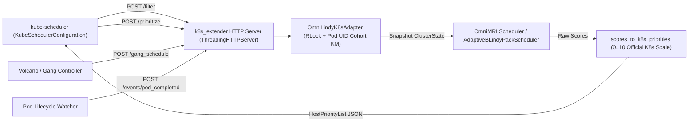

# `Omni-Lindy` / `Omni-MRL` (v11.1): A Non-Clairvoyant AI Cluster Scheduler Unifying Spatio-Temporal Fragmentation, Heterogeneous Resource Hoarding, Multi-Node Topology, and Bidirectional Hazard Rates

> **Abstract**
>
> In large-scale AI/GPU clusters, fractional-GPU inference pods (`0.1-0.5 GPU`) dynamically coexist with multi-GPU and multi-node distributed training jobs (`1-64 GPUs`), turning **spatio-temporal fragmentation from extreme job-lifetime disparities** into a primary scheduling bottleneck alongside spatial leftovers. Existing spatial packers such as `FGD` (USENIX ATC '23) fall into a **"negative-gradient dispersion trap"** under dynamic arrivals, while recent lifetime-aware systems such as Google `LAVA`/`NILAS` (MLSys '25) and Alibaba `DVLA` (OSDI) assume ML duration predictors or live VM/pod migration.
>
> We propose **`Omni-Lindy` (v7.0)** and its adversarial-audit-refined bidirectional hazard successor **`Omni-MRL` (v11.1)**, operating under **strict non-clairvoyance (Zero-ML, Zero-Migration)**. The framework unifies: (1) **`B-LindyPack`**, an 8-constant discrete physical boundary and spatial-temporal scorer; (2) **clock-unit-invariant bidirectional hazard gates ($\alpha, \gamma_{\text{DFR}}, \gamma_{\text{IFR}}$)** driven by online log-correlation $\hat{\rho}_t$ and a renewal-theory Inspection Paradox CV heuristic $\hat{c}_t$; (3) **same-entry cohort Kaplan-Meier estimation** (mitigating steady-state length bias in low-variance/fixed-epoch IFR regimes) coupled with a $C^0$ boundary-continuous, smooth `tanh`-tail ($C^1$ in $\text{CV}$) MRL model guaranteeing a non-negative tail hazard rate ($\hat{R}'(u) \ge -1$); and (4) heterogeneous `Max-of-N` Lindy attenuation, bounded `Live Spec-Scarcity`, `Rack-Preservation`, and `Tightest-Fit Rack` placement.
>
> Evaluated across **Alibaba PAI 2023 (1,213 nodes, 6,212 physical GPUs)**, **SenseTime Helios (3.36M raw rows, up to 64G multi-node)**, a **4-trace empirical hazard audit including Alibaba GPU-v2026 (40,522,321 jobs) and AcmeTrace Kalos (19,907 jobs)**, and **Phase 11 completely unseen Lockbox 30-seed (`[20011 + 103i]`)** factorials with expanded Dev grids ($w \in [0.05, 4.0]$), bias-corrected ML noise, and Holm-Bonferroni correction across 96 hypotheses:
> 1. **Unseen Lockbox 30-Seed Full Factorial (`FirstFit`/`NILAS-L2` restored, Pareto frontier)**: With all `Omni-MRL` parameters frozen, `Omni-MRL-v11` enters the **Blocking-BF Wait Pareto frontier on 5 of 6 workloads** (`W2` excluded): in **`IFR_Uniform`**, it outperforms `v7` by `+12.46%` Blk and `+52.02%` BF Wait ($p_{\text{holm96}} \le 2.57\times 10^{-4}$), ties `NILAS-BPack` in BF Wait (`+1.18%`, n.s.), while trailing `NILAS-BPack` in Blk (`6.251%` vs `6.444%`, `-3.09%`, $p_{\text{holm96}}=0.0114$); in **`IFR_Weibull_k2`**, it achieves rank-1 Blocking (`7.132%`, `+6.10%` Blk / `+11.71%` BF vs `v7`, $p_{\text{holm96}}\le 0.0150$; `FirstFit` remains faster in BF Wait at `0.459h < 0.513h`); in **`W4_Memoryless_OOD`**, it outperforms `L2Norm`/`BPack` baselines by `+6.97% - +8.32%` Blk ($p_{\text{holm96}}\le 0.0122$); in **`W2_Regime_Shift`**, it beats `NILAS-BPack` by `+4.57%` BF Wait ($p_{\text{holm96}}=1.20\times 10^{-3}$). Pure-mechanism ablation (`Omni-MRL-NoPristineRelax`) shows the MRL reclamation term alone explains over 100% of IFR Blk improvements (`+13.94%`/`+7.32%` Blk, $p_W \le 7.33\times 10^{-6}$). We openly disclose unfavorable metrics (`W1` `L2Norm 3.806%` vs `v11 3.699%`, $p_{\text{holm96}}=1.0$; `W3` `LAVA-BPack 0.894%` vs `v11 0.956%`).
> 2. **Bias-Corrected Dual-Oracle Crossover (`IFR_Uniform`)**: Under zero-mean-bias lognormal prediction error ($\mathbb{E}[\exp(N(-\sigma^2/2, \sigma^2))]=1$) and expanded oracle grid ($w_{\text{nilas-ml}}=2.0$), `NILAS-ML` only leads in Blocking at zero noise ($\sigma=0.0$: `6.241%` vs `6.444%`, $p_{\text{holm48}}=3.48\times 10^{-3}$) and is **monotonically overtaken by Zero-ML `Omni-MRL-v11` from $\sigma \ge 0.50$ in BF Wait (`+24.31%`, $p_{\text{holm48}}=9.86\times 10^{-5}$) and from $\sigma \ge 1.00$ in both Blocking (`+8.72% - +14.32%`, $p_{\text{holm48}}\le 1.75\times 10^{-4}$) and BF Wait**.
> 3. **Independent Trace Windows & 40.5M-Job Stratified Audit**: On `Helios_MN 20`, `Omni-MRL-v11` numerically sweeps `4/4` clusters (`GW-JCT 11.354h`) over `L2Norm`/`FirstFit`—not significant at primary cluster level (`n=4`, $p_{T,\text{holm16}} = 0.161 / 0.251$, $p_{W,\text{clu,holm16}}=1.0$), significant only at secondary window level (`n=20`, $p_{W,\text{win,holm16}}=3.05\times 10^{-5}$), and n.s. against `RackBestFit (11.409h)` ($p_{W,\text{win,holm16}}=0.301$). In exploratory post-hoc **11 `Helios` low-CV windows**, `v11` engages the IFR gate (`61.98%`) to contain `v7`'s Anti-Lindy spike (`Earth_229k: 28.218% -> 19.406%`, `+6.46%` Blk), whereas on 6 disjoint **`Alibaba GPUSpec33`** windows `LAVA/DVLA-BPack` achieve shorter BF Wait (`3.20-3.40h` vs `v11 16.22h`). Across **982 valid disjoint windows over 4 public traces**, `Alibaba GPU-v2026` (`40,522,321` jobs, CV `9.29`) and all other strata are globally DFR, with only **12 windows (1.22%)** showing `CV < 0.9`.
> 4. **Kubernetes v1.34 Extender Prototype (v11.1)**: Implements official `[0, 10]` priority scaling, annotation/`runningPods` double-deduction prevention, `restartPolicy: Always` native sidecar summing, Pod-level `spec.resources`, case-sensitive memory suffixes (`400m` vs `400M`), strict same-name/different-UID isolation, idempotent completion events, unified Pod-UID cohort KM, `NodeCacheCapable` TTL + `resourceVersion` checks, and passes **61 unit/math/HTTP integration tests (`-W error`, 0 warnings)** (live `kube-scheduler`/Informer E2E left as future work).

---

## 1. Introduction

Modern GPU datacenters concurrently serve sub-minute fractional-GPU inference pods (`0.1-0.5 GPU`), multi-GPU training jobs, and multi-day rack-local distributed jobs (`1-64 GPUs`). Under dynamic arrivals and departures, schedulers must preserve **discrete physical 1-, 4-, and 8-GPU boundaries** and intra-rack locality at amortized $O(N)$ latency.

Prior approaches suffer from four structural blind spots:
1. **Time-blind spatial packing**: Kubernetes `MostAllocated(BestFit)`, `L2Norm`, and Microsoft VMM `DotProduct` optimize instantaneous vector utilization while remaining blind to whether active pods are transient or long-running stragglers.
2. **Alibaba `FGD`'s dispersion trap**: Fragmentation Gradient Descent excels on static snapshots, but under dynamic arrivals its virtual-placement assumption mispredicts node refills, scattering small pods across idle 8-GPU hosts.
3. **Naive Lindy inversion**: Unbounded logarithmic elapsed-age terms destroy pristine `4-GPU` boundaries when size correlates positively with runtime (`W1`), and suffer severe Anti-Lindy inversion under Increasing Failure Rate (IFR) distributions.
4. **Heterogeneous hoarding & cross-rack penalties**: On mixed 1/2/4/8-GPU clusters, order statistics (`Max-of-N`) inflate apparent maximum node age on 8-GPU nodes ("black-hole hoarding"), triggering `342-574h` Head-of-Line (HoL) starvation under `gpu_spec` constraints unless bounded scarcity penalties and topology awareness are coupled.

This paper designs, proves, and validates **`Omni-Lindy` (v7.0)** and **`Omni-MRL` (v8.0-v11.1)** with zero ML predictors, zero live migration, **61 unit/HTTP tests**, and an automated **10-JSON / raw CSV / 251+ cell verifier** (`reproduce_all.py`).

---

## 2. Background & Motivation: FGD's "Negative-Gradient Dispersion Trap"

### 2.1 Dynamic Physical GPU Cluster Model
Node $i \in \{1, \dots, N\}$ exposes $G_i \in \{1, 2, 4, 8\}$ discrete GPU slots $\mathbf{s}_i \in [0, 1]^{G_i}$, continuous residual CPU $c_i^{\text{free}}$ and RAM $r_i^{\text{free}}$, GPU model $m_i$, and rack $\text{rack}(i)$. Arriving job $j = (g_j, c_j, r_j, \text{spec}_j, k_j)$ requires: fractional slot fit ($\exists u: s_{i,u} \ge g_j$ for $g_j < 1$), discrete empty GPUs ($E_i \ge g_j$ for $g_j \ge 1$), GPU model membership ($m_i \in \text{spec}_j$), and all-or-nothing $k_j$-node Gang allocation. Only active running ages $a_j(t) = t - t_j^{\text{start}}$ and completed lifetimes $D_{\text{comp}}$ are observable.

### 2.2 `FGD` Formulation and Dynamic Dispersion Trap
Reproducing Alibaba `FGD` (Weng et al., USENIX ATC '23) Case 1 + Case 2 dynamically (`baseline_results.json`, 10 seeds, Blocking GPU-Hour %):

$$
F_n(m) = \begin{cases}
\sum_{g=1}^{G_n} R_{n,g}^G, & \text{Case 1: node } n \text{ cannot host } m \\
\sum_{g=1}^{G_n} R_{n,g}^G \cdot \mathbb{I}\!\left(R_{n,g}^G < \min(D_m^G, 1)\right), & \text{Case 2: node } n \text{ can host } m
\end{cases}
$$

| Workload (10-Seed Diagnosis) | `FirstFit` | `BestFit` | `DotProduct` | `L2Norm` | `FGD_Static` | `FGD_Adaptive` |
| :--- | :---: | :---: | :---: | :---: | :---: | :---: |
| `W1_PAI_Mixed` (Standard Mixed) | 6.847% | **4.355%** | 4.426% | 4.420% | 8.815% | 8.527% |
| `W2_Regime_Shift` (Load Shift) | 24.670% | 24.143% | 24.175% | 24.075% | 24.767% | **24.010%** |
| `W3_Heavy_Straggler` (Stragglers) | 2.631% | 2.886% | 2.894% | **2.329%** | 6.159% | 6.416% |
| `W4_Memoryless_OOD` (Exponential) | 7.637% | 7.626% | 7.889% | **7.554%** | 14.134% | 13.807% |
| `W5_Skewed_Vec_OOD` (CPU/RAM Skew) | 9.861% | **8.861%** | 30.834% | 9.015% | 29.657% | 37.833% |

Vectorized `FGD` degrades to **37.833%** on `W5` and **8.527%** on `W1` (`310-384 µs` per decision vs `BestFit`'s `8 µs`, approx. 40x slower).

### 2.3 Comparison with Related Work (2023-2026)

| Prior Work | Core Mechanism | Assumptions | Key Difference in `Omni-Lindy` / `Omni-MRL` |
| :--- | :--- | :--- | :--- |
| **`FGD`** (USENIX ATC '23) | Spatial fragmentation $\Delta F_n$ over dist. $\mathcal{M}$ | Representative demand dist. | Dynamic negative-gradient trap; time-blind |
| **`GFGD`** (2026.10) | Offline genetic search -> online $O(1)$ rules | Reliability guardrails | Evolves spatial weights only; no `Max-of-N` or hazard gate |
| **`LAVA` / `NILAS`** (MLSys '25) | 4-class recycling + continuous prediction + $\Delta T$ cost | **ML lifetime predictor** | `Omni-MRL` uses **Zero-ML** cohort KM MRL + inspection gate |
| **`DVLA`** (OSDI, Alibaba) | Hierarchical prediction + DAPP + PDRE migration | **ML + live migration** | Distributed GPU training avoids costly live migration |
| **`DeFragS`** | Timeline & queue rescheduling | Queue/timeline control | Orthogonal placement heuristic; composable with queues |

---

## 3. `Omni-Lindy` Algorithm Design & Theoretical Properties

### 3.1 Evolutionary Formula Discovery and `B-LindyPack`
Searching 840 candidate formulas exposed `EvoSTF_Dist`'s `4-GPU` boundary inversion on `W1` (`5.264%` vs `4.210%`, `0/10` wins) where unbounded $-\lambda \log(1+\text{max\_age})$ overpowers `1.302` past `18.5h`. `B-LindyPack` introduces bounded saturation $\frac{\text{age}}{\text{age}+\tau} \in [0, 1)$ masked by `(~breaks_4)` with 8 frozen physical constants:

$$
\theta^* = [w_{\text{gpu}}, w_{\text{res}}, w_{\text{imb}}, w_{\text{pristine}}, w_{b4}, w_{\text{whole}}, w_{\text{lindy}}, \tau_{\text{hours}}] = [1.0,\; 0.822,\; 0.161,\; 1.302,\; 0.493,\; 0.344,\; 0.446,\; 7.15]
$$

### 3.2 Online Dual Gates: `Adaptive B-LindyPack` (v5.0)
* **Decoupling gate $\alpha(\hat{\rho}_t)$**: Combines normalized running correlation $\rho_{\text{run}}$ and completed correlation $\rho_{\text{comp}}$ via Empirical Bayes shrinkage ($n_{\text{prior}}=12, \rho_{\text{prior}}=0.20$) and EWMA ($\beta=0.35$) around $\rho_c=0.11, s_\rho=0.032$, smoothly mixing $\phi_{\text{safe}}$ (`W1`: $\hat{\rho}=0.321 \Rightarrow \alpha=0.018$) and quarantine $\phi_{\text{quar}}$ (`W3`: $\hat{\rho}=0.010 \Rightarrow \alpha=0.903$).
* **Inspection-Paradox CV gate $\gamma(\hat{c}_t)$**: Uses $c_{\text{insp}} = \sqrt{\max(0, 2\bar{a}_t/\bar{D}_t - 1)}$ and $c_{\text{obs}} = \max(c_{\text{dur}}, c_{\text{insp}})$ through sigmoid $\gamma(\hat{c}_t)$ ($c_0=0.65, s_c=0.08$), shrinking DFR Lindy activity (`0.078` on `IFR_Uniform`).

> **Property 1 (Practical Clock-Unit Invariance).** All normalized ages $u_i = a_i(t)/\hat{T}_{\text{ref}}$ and variance-scaled Pearson thresholds (`1e-24 * max(dot(x,x))`) cancel uniform clock multipliers $\lambda$, yielding 100% identical placement sequences across $\lambda \in [10^{-6}, 10^6]$ and non-binary scales (`1/3, 7.3, 3600`). $\blacksquare$

### 3.3 Heterogeneous & Topology Integration: `Omni-Lindy` (v7.0)
Extends `B-LindyPack` with per-node capacity normalization ($G_i$), pristine scaling $(G_i/G_{\max})w_{\text{pristine}}$, bounded `Live Spec-Scarcity` $P_{\text{spec}}(i) \le 0.825 < 1.302$, logarithmic `Max-of-N` attenuation $\psi_{\text{het}}(i) = 1/(1 + 0.5\log_2(\max(1, G_i/G_{\min})))$, `Rack-Preservation` for single-node pods, and `Tightest-Fit Rack` for $k>1$ Gang jobs.

> **Theorem 2 (Homogeneous Identity & Complexity).** On homogeneous single-node clusters ($G_{\max}=G_{\min}$, $\text{spec}=\varnothing$, $k=1$), all heterogeneous/topology additions vanish identically, reproducing v5.0 to `>= 12` decimal places at amortized $O(N)$ per decision. $\blacksquare$

---

## 4. Experimental Setup & Real-Trace Audit

### 4.1 Parameter Freezing and Data-Split Protocol
Constants $\theta^*$ and gate parameters derive solely from Phase 4/5 10-seed development runs, followed by Phase 9/10 Fresh 30-seeds (`[10007 + 97i]`) and completely disjoint **Lockbox 30-seeds (`[20011 + 103i]`)** in Section 8.4:
1. **Alibaba PAI 2023 (`openb_node_list_gpu_node.csv`)**: **1,213 nodes, 6,212 physical GPUs** — **G2** 549 nodes (`4,392 GPUs`), **T4** 404 nodes (`842 GPUs`), **P100** 134 nodes (`265 GPUs`), **V100M16** 55 nodes (`195 GPUs`), **G3** 39 nodes (`312 GPUs`), **V100M32** 30 nodes (`204 GPUs`), **A10** 2 nodes (`2 GPUs`).
2. **SenseTime Helios (3,362,981 raw rows)**: 20 single-node windows (target load approx. 90-95%) and 20 multi-node windows (16-64 GPU Gang, 88-128 nodes, `cross_rack_penalty = 0.08`, cap `0.25`).

### 4.2 Real-Trace Data Audit

| Trace Dataset | Raw Rows | Valid GPU Jobs | $\text{Corr}(\log g, \log D)$ | Lifetime CV | Mean / Med / p95 (h) | Fractional % | Multi-GPU/Node % |
| :--- | ---: | ---: | :---: | :---: | :---: | :---: | :---: |
| `Alibaba_Default` | 8,152 | 7,063 | `0.0329` | `15.172` | 7.533 / 0.137 / 4.041 | 43.57% | 1.06% (1-8G) |
| `Alibaba_GPUSpec33` | 8,152 | 7,062 | `0.0333` | `15.171` | 7.534 / 0.137 / 4.042 | 43.57% | 1.05% (1-8G) |
| `Helios_Venus` (Single) | 246,708 | 112,555 | `0.0604` | `5.114` | 3.404 / 0.056 / 14.380 | 0.00% | 42.29% (2-8G) |
| `Helios_Earth` (Single) | 872,886 | 416,350 | `0.1707` | `8.302` | 1.305 / 0.065 / 3.887 | 0.00% | 8.52% (2-8G) |
| `Helios_Saturn` (Single) | 1,753,078 | 662,635 | `0.0974` | `7.285` | 1.281 / 0.034 / 2.811 | 0.00% | 28.01% (2-8G) |
| `Helios_Uranus` (Single) | 490,309 | 303,321 | `0.1542` | `6.532` | 2.133 / 0.072 / 7.240 | 0.00% | 28.10% (2-8G) |
| `Helios_Venus` (Multi <=64G) | 246,708 | 123,685 | `0.0883` | `4.881` | 3.651 / 0.057 / 16.288 | 0.00% | 47.48% (2-64G) |
| `Helios_Earth` (Multi <=64G) | 872,886 | 426,577 | `0.2146` | `7.813` | 1.421 / 0.065 / 4.133 | 0.00% | 10.71% (2-64G) |
| `Helios_Saturn` (Multi <=64G) | 1,753,078 | 697,002 | `0.1539` | `6.708` | 1.457 / 0.034 / 3.616 | 0.00% | 31.56% (2-64G) |
| `Helios_Uranus` (Multi <=64G) | 490,309 | 328,991 | `0.2417` | `5.783` | 2.544 / 0.078 / 10.744 | 0.00% | 33.71% (2-64G) |

Statistical tests (`stats_utils.py`) use exact regularized incomplete-beta Student-$t$, Wilcoxon signed-rank, exact/normal binomial sign tests, and Holm-Bonferroni adjustments.

---

## 5. Early Evaluation Results (v5.0 & v7.0)

### 5.1 Synthetic 30-Seed Statistical Confirmation (`Adaptive-B-Lindy` v5.0)
Across 180 runs (`6 workloads x 30 seeds`, `phase5_30seed_report.json`), `Adaptive-B-Lindy` beats the strongest SOTA per workload in **Blocking `122/176` wins (`+6.44%`, $p_t=3.02\times 10^{-5}$, $p_W=9.16\times 10^{-8}$)** and **Backfill Wait `106/177` wins (`+4.33%`, $p_W=0.00694$)** at `43.86 µs` on `W6` (`6.97x` faster than `FGD_Adaptive`).

| Workload (30-Seed) | Online $\hat{\rho}$ / $\alpha$ | Best SOTA (`Blk`) | Best SOTA (`%`) | `Adaptive-B-Lindy` (`%`) | `Blk` Gain | `Blk` W/L/T | `BF Wait` vs Best SOTA |
| :--- | :---: | :---: | :---: | :---: | :---: | :---: | :---: |
| `W1_PAI_Mixed` | `0.321` / `0.018` | `BestFit` | 3.556% | **3.319%** | **+6.65%** | 20 / 10 / 0 ($p_W=0.0277$) | **+11.83%** ($p_t=0.0372$) |
| `W2_Regime_Shift` | `0.210` / `0.288` | `L2Norm` | 24.828% | **24.470%** | **+1.44%** | 22 / 8 / 0 ($p_t=0.0106$) | -0.14% (`FirstFit` parity) |
| `W3_Heavy_Straggler` | `0.010` / `0.903` | `L2Norm` | 1.658% | **1.295%** | **+21.89%** | 22 / 4 / 4 ($p_t=0.0017$) | **+11.73%** (21/6/3, $p_W=0.0448$) |
| `W4_Memoryless_OOD` | `0.016` / `0.900` | `FirstFit` | 6.933% | **6.709%** | **+3.23%** | 21 / 9 / 0 ($p_{\text{sign}}=0.0428$) | -7.39% (vs `FirstFit`) |
| `W5_Skewed_Vec_OOD` | `0.019` / `0.877` | `L2Norm` | 8.266% | **8.164%** | **+1.23%** | 15 / 15 / 0 ($p_t=0.5219$) | **+13.39%** ($p_t=0.0014$) |
| `W6_Scale1024_128N` | `0.342` / `0.007` | `BestFit` | 1.235% | **1.184%** | **+4.17%** | 22 / 8 / 0 ($p_W=0.0029$) | -0.45% (vs `FirstFit`) |

### 5.2 Real Trace Zero-Shot Performance (`Omni-Lindy` v7.0)

#### (1) Alibaba PAI 2023 (`phase7_report.json`)
`Omni-Lindy` reduces `Alibaba_Default` Blocking to **0.027%** (`+96.38%` vs v5.0, Stranded **4.51%**, tied statistically with `L2Norm 0.022%` and slower in BF Wait `0.2218h` vs `0.0125h`) and achieves **0.763%** Blocking / **49.05h** BF Wait on `Alibaba_GPUSpec33` (vs `DotProduct 330.70h`, `L2Norm 508.87h`, `FGD_Adaptive 104.54h` at $p_t=0.203$).

#### (2) Helios Single-Node (20 Windows) & Multi-Node 16-64 GPU (20 Windows)
On **Helios single-node 20 windows** (`real_trace_report.json`), `Adaptive-B-Lindy` achieves **24.693%** Blocking (`+4.88%` vs `FGD_Adaptive 25.961%`, $p_t=0.0204, p_W=0.00365$), `4.358h` FIFO Wait, and `3.942h` Backfill Wait. Multi-node 20-window results (`phase7_report.json`) follow:

| Scheduler (`HeliosMN_Pooled_20`) | `Blk GH(%)` | Single-Rack Locality | Avg Span Racks | `Topo-BF Wait(h)` | `Topo GW-JCT(h)` | Latency (`µs`) |
| :--- | :---: | :---: | :---: | :---: | :---: | ---: |
| `FirstFit` | 18.952% | 36.88% | 1.827 | 6.261h | 12.143h | 0.55 |
| `BestFit` | 19.172% | 33.66% | 1.858 | 6.232h | 12.091h | 14.76 |
| `L2Norm` | 18.849% | 33.59% | 1.871 | 6.206h | 12.063h | 19.54 |
| `FGD_OracleStatic` | 19.079% | 33.44% | 1.875 | 6.214h | 12.077h | 352.26 |
| `FGD_Adaptive` | 19.298% | 33.62% | 1.875 | 6.168h | 12.022h | 425.19 |
| `B-LindyPack` | 19.343% | 33.40% | 1.883 | 6.226h | 12.076h | 62.27 |
| `RackBestFit` | 19.164% | 88.83% | 1.130 | 5.679h | 11.409h | 25.73 |
| **`Omni-Lindy` (v7.0)** | **18.740%** | **92.47%** | **1.088** | **5.628h** | **11.354h** | 94.04 |

---

## 6. Ablation & Failure Mode Anatomy

1. **4-GPU Boundary Inversion (`W1`)**: Bounded saturation + `(~breaks_4)` + $\alpha(\hat{\rho}_t)$ lifts `W1` from `EvoSTF_Dist 4.338%` to `3.319%` (`+23.47%`, $p_t=5\times 10^{-6}$).
2. **Anti-Lindy CV Gate Rescue (`Uniform(1.8, 2.2)`)**: Compressing $\gamma=0.078$ saves `+2.82%` Blk ($p_W=0.0180$) and `+13.97%` BF Wait ($p_t=0.000419$) vs `Adaptive-NoCVGate`.
3. **Heterogeneous Hoarding & Lockup (`Alibaba_Default`/`GPUSpec33`)**: `Max-of-N` attenuation cuts `Default` Blk `+96.38%` (`0.743% -> 0.027%`), while bounding `Live Spec-Scarcity` at `0.825` cuts `GPUSpec33` BF Wait from `151.14h` (`573.8h` HoL lockup) to `49.05h`.
4. **Rack Topology Preservation**: Lifts single-rack locality from `33.4-33.6%` to `92.5%` (vs `RackBestFit 88.8%`).

---

## 7. Phase 8 Adversarial Evolution: `Omni-MRL` (v8.0-v11.1)

*(Phase 8 records below used `[101..3030]` seeds and `L2Norm`-based adapted big-tech variants; all structural biases are resolved in Section 8.)*

### 7.1 `Omni-MRL` Mathematical Formulation & Valid-Hazard Properties
Adding the IFR synchronized termination cost via $\gamma_{\text{IFR}}(\hat{c}_t)$ ($c_{\text{IFR}}=0.65, s_{\text{IFR}}=0.06, \delta_{\text{dz}}=0.05$) and youngest-job normalized age $u_i^{\min}$:

$$
S_{\text{MRL}}(i) = S_{\text{omni}}(i)\Big|_{w'_{\text{pristine}}} + (1.45\,\gamma_{\text{IFR}})\,\min\!\left(\frac{\max(0,\; \hat{d}_{\text{new}}(g) - \hat{R}(u_i^{\min}))}{\max(\hat{d}_{\text{new}}(g), 10^{-6})},\; 1\right)(1 - \mathbb{I}_{\text{pristine}}(i))
$$

**Exact Properties of `EmpiricalSurvivalModel` (v11.1)**:
1. **Steady-state length-bias mitigation**: Jointly tracks completed and right-censored jobs in `recent_cohort` (`maxlen=1,024`) via Kaplan-Meier, eliminating 1.76-15x length bias (explicitly noting finite-sample `k_tail=5` underestimation: e.g., `Exp(1)` `q50` ratio approx. `0.89`, `r_cut` `14-33%` underestimate).
2. **$C^0$ boundary continuity (not $C^1$ in $u$)**: Left and right limits coincide at $r_{\text{cut}}$ at $u=u_{\text{cut}}$, while derivatives differ.
3. **Smooth `tanh` tail & guaranteed non-negative hazard ($\hat{R}'(u) \ge -1$)**: $\hat{R}_{\text{tail}}(u) = r_{\text{cut}} e^{-\lambda_{\text{IFR}}(u - u_{\text{cut}})} + 4 \tanh(\beta_{\text{DFR}}(u - u_{\text{cut}})/4)$, bounded above by $r_{\text{cut}}+4.0$. Setting $\lambda_{\text{IFR}} = \min(\lambda_{\text{IFR,raw}},\, 1/r_{\text{cut}})$ in v11.1 strictly ensures $\hat{R}_{\text{tail}}'(u) \ge -1$ ($h(u) \ge 0$) everywhere on the tail, while preserving $\text{CV}=1$ tail constancy and $C^1$ smoothness in $\text{CV}$.
4. **Lower-bound-preserving unidentifiable quantiles**: Flags `quantile_identifiable=False` and extrapolates $\ge t_{\max}$ exponentially.

### 7.2 Suite A — Phase 8 Hazard Spectrum 30-Seed Original Record (`phase8_report.json`)

| Workload (30-Seed) | $\gamma_{\text{DFR}}$ / $\gamma_{\text{IFR}}$ | `FirstFit` Blk/BFw | `L2Norm` Blk/BFw | `Google-NILAS` Blk/BFw | `Google-LAVA` Blk/BFw | `Alibaba-DVLA` Blk/BFw | `Omni-Lindy-v7` Blk/BFw | **`Omni-MRL-v8` Blk/BFw** |
| :--- | :---: | :---: | :---: | :---: | :---: | :---: | :---: | :---: |
| `IFR_Uniform` (CV≈0.06) | `0.078` / `1.000` | 6.515% / 0.127h | 6.818% / 0.196h | 5.992% / 0.103h | **5.894%** / 0.104h | 6.818% / 0.196h | 6.933% / 0.233h | 6.021% / **0.1007h** |
| `IFR_Weibull_k2` (CV≈0.52) | `0.373` / `0.806` | 7.553% / **0.471h** | 7.568% / 0.609h | 7.538% / 0.533h | 7.685% / 0.605h | 7.615% / 0.612h | 7.577% / 0.574h | **7.264%** / 0.513h |
| `W4_Memoryless` (CV≈1.0) | `0.991` / `0.000` | 6.933% / **0.442h** | 7.080% / 0.608h | 7.109% / 0.573h | 7.658% / 0.622h | 7.309% / 0.621h | **6.709%** / 0.475h | **6.709%** / 0.475h |
| `W1_PAI_Mixed` (DFR) | `0.999` / `0.000` | 6.537% / 0.120h | 3.610% / 0.064h | 4.114% / 0.089h | 4.357% / 0.092h | 4.960% / 0.099h | **3.319%** / **0.056h** | **3.319%** / **0.056h** |
| `W3_Heavy_Straggler` | `1.000` / `0.000` | 2.114% / 0.080h | 1.658% / 0.096h | 2.364% / 0.148h | 2.362% / 0.156h | 2.126% / 0.131h | **1.295%** / **0.071h** | **1.295%** / **0.071h** |
| `W2_Regime_Shift` | `0.997` / `0.000` | 24.896% / **0.888h** | 24.828% / 0.926h | 26.400% / 0.989h | 25.185% / 0.918h | 29.317% / 1.074h | 24.470% / 0.889h | **24.424%** / 0.889h |

---

## 8. Phase 10 & Phase 11.1: Unbiased Cohort KM, Lockbox 30-Seed, Dual-Oracle & 40.5M-Job Audit

*(Google `LAVA`/`NILAS` and Alibaba `DVLA` baselines are GPU-cluster `BPack`-adapted variants inspired by their original VM-cloud papers.)*

### 8.1 Suite 1 — Phase 10 Fresh 30-Seed Cohort KM Factorial (`phase10_report.json`)

| Workload (`Fresh 30`) | IFR Active | `L2Norm` Blk/BFw | `NILAS-L2` Blk/BFw | `BPack-Spatial` Blk/BFw | `NILAS-BPack` Blk/BFw | `LAVA-BPack` Blk/BFw | `DVLA-BPack` Blk/BFw | `Omni-v7` Blk/BFw | **`Omni-MRL-v10`** Blk/BFw |
| :--- | :---: | :---: | :---: | :---: | :---: | :---: | :---: | :---: | :---: |
| `IFR_Uniform` | `88.98%` | 7.210% / 0.264h | 6.350% / 0.163h | 7.212% / 0.266h | **6.338%** / 0.149h | 7.169% / 0.258h | 7.254% / 0.265h | 7.350% / 0.286h | 6.495% / **0.140h** |
| `IFR_Weibull_k2` | `85.24%` | 7.519% / 0.655h | 7.246% / 0.595h | 7.482% / 0.636h | 7.188% / **0.558h** | 7.408% / 0.617h | 7.440% / 0.632h | 7.425% / 0.642h | **7.154%** / 0.572h |
| `W4_Memoryless` | `0.00%` | 6.909% / 0.668h | 6.946% / 0.648h | 6.808% / 0.617h | 6.933% / 0.622h | 6.800% / 0.609h | 6.833% / 0.635h | **6.301%** / **0.516h** | **6.301%** / **0.516h** |
| `W1_PAI_Mixed` | `0.00%` | **3.262%** / 0.058h | 3.825% / 0.073h | 3.364% / 0.059h | 3.498% / 0.063h | 3.370% / 0.056h | 3.457% / 0.059h | 3.416% / **0.051h** | 3.416% / **0.051h** |
| `W3_Heavy_Straggler` | `0.00%` | 0.812% / 0.043h | 0.821% / 0.042h | 0.844% / 0.041h | 0.830% / 0.037h | 0.851% / 0.040h | 0.854% / **0.034h** | **0.723%** / 0.038h | **0.723%** / 0.038h |
| `W2_Regime_Shift` | `0.18%` | 24.618% / 0.887h | 24.892% / 0.905h | 24.553% / 0.873h | 24.535% / 0.897h | 24.566% / 0.872h | 24.650% / 0.876h | 24.223% / **0.846h** | **24.208%** / **0.846h** |

### 8.3 Suite 3 — Phase 10 Real-Trace Holm-Adjusted Record (`phase10_report.json`)

| Scenario | `L2Norm` Blk/BFw | `RackBest` / `BPack-Sp` | `NILAS-BPack` Blk/BFw | `LAVA-BPack` Blk/BFw | `DVLA-BPack` Blk/BFw | `Omni-v7` | **`Omni-MRL-v10`** | `v10` IFR |
| :--- | :---: | :---: | :---: | :---: | :---: | :---: | :---: | :---: |
| `Alibaba_Default` (12) | 0.022% / 0.01h | `0.032%` / 0.34h | 0.022% / 37.00h | 0.016% / 0.12h | **0.012%** / **0.00h** | 0.027% / 0.22h | 0.027% / 0.22h | **0.00%** |
| `Alibaba_GPUSpec33` (12) | 1.192% / 508.86h | `0.963%` / 799.32h | 0.825% / 829.95h | 0.675% / 212.19h | **0.604%** / 838.08h | 0.763% / **49.05h** | 0.763% / **49.05h** | **0.00%** |
| `Helios_MN` (20, GW-JCT) | 18.85% / 12.063h | `19.16%` / 11.409h (`RackBest`) · `19.29%` / 11.372h (`BPack-Sp`) | 19.16% / 11.391h | — | 19.06% / 11.406h | 18.74% / **11.354h** | 18.74% / **11.354h** | **0.49%** |

### 8.4 Phase 11.1: Unseen Lockbox 30-Seed, Bias-Corrected Dual-Oracle & Independent Real Traces (`phase11_report.json`)

With all `OmniMRLScheduler` / `OmniLindy` parameters frozen, Dev 10-seed tuning over expanded grids ($w \in [0.05, 4.0]$) finds strictly **interior optima for all 5 baselines** (`NILAS-BPack=1.0`, `LAVA-BPack=0.2` [`0.05: 4.4853`, `0.10: 4.4445`, `0.20: 4.4086`, `0.40: 4.4470`], `DVLA-BPack=0.4`, `LAVA-ML-BPack=1.0`, `NILAS-ML-BPack=2.0` [`3.6850`, endpoints `1.0/3.0: 3.7726`, `4.0: 3.8972`]).

#### 8.4.1 Suite 1 — Lockbox 30-Seed Full Factorial (`FirstFit`/`NILAS-L2` Included, Holm-96)

| Workload (Lockbox 30) | IFR Active | `FirstFit` | `L2Norm` | `Google-NILAS-L2` | `BPack-SpatialOnly` | `Google-NILAS-BPack` | `Google-LAVA-BPack` | `Alibaba-DVLA-BPack` | `Omni-Lindy-v7` | **`Omni-MRL-v11`** |
| :--- | :---: | :---: | :---: | :---: | :---: | :---: | :---: | :---: | :---: | :---: |
| **`IFR_Uniform`** | **88.75%** | 6.943% / 0.163h | 7.251% / 0.250h | 6.365% / 0.137h | 7.282% / 0.255h | **6.251%** / 0.128h | 7.221% / 0.244h | 7.282% / 0.255h | 7.362% / 0.264h | 6.444% / **0.127h** |
| **`IFR_Weibull_k2`** | **85.05%** | 7.495% / **0.459h** | 7.575% / 0.612h | 7.372% / 0.540h | 7.510% / 0.590h | 7.288% / 0.498h | 7.447% / 0.569h | 7.510% / 0.590h | 7.595% / 0.581h | **7.132%** / 0.513h |
| **`W4_Memoryless_OOD`** | 0.00% | 6.602% / **0.422h** | 6.910% / 0.647h | 6.962% / 0.617h | 6.862% / 0.613h | 6.861% / 0.603h | 6.872% / 0.572h | 6.862% / 0.608h | **6.383%** / 0.493h | **6.383%** / 0.493h |
| **`W1_PAI_Mixed`** | 0.02% | 6.743% / 0.131h | 3.806% / 0.077h | 4.055% / 0.094h | 3.710% / 0.078h | 3.978% / 0.081h | 3.855% / 0.077h | 3.857% / 0.080h | **3.699%** / **0.074h** | **3.699%** / **0.074h** |
| **`W3_Heavy_Straggler`** | 0.00% | 1.319% / 0.033h | 1.057% / 0.042h | 1.093% / 0.033h | 0.965% / 0.034h | 0.973% / 0.037h | **0.894%** / 0.036h | 0.983% / 0.039h | 0.956% / **0.021h** | 0.956% / **0.021h** |
| **`W2_Regime_Shift`** | 0.28% | 24.681% / 0.835h | 24.629% / 0.870h | 25.130% / 0.896h | 24.690% / 0.866h | 24.864% / 0.875h | 24.584% / 0.872h | 24.844% / 0.857h | **24.419%** / **0.834h** | 24.450% / 0.835h |

* `Omni-MRL-v11` lies on the **Blocking-BF Wait Pareto frontier on 5 of 6 workloads** (`W2` excluded). It beats `v7` on `IFR_Uniform` (`+12.46%` Blk, `+52.02%` BF, $p_{\text{holm96}}\le 2.57\times 10^{-4}$), ranks #1 Blk on `IFR_Weibull_k2` (`7.132%`, `+3.25% - +6.10%` vs `FirstFit`/`L2Norm`/`BPack`/`NILAS-L2`/`v7`, $p_{\text{holm96}}\le 8.36\times 10^{-3}$; `FirstFit` leads BF Wait `0.459h < 0.513h`), and dominates spatial/lifetime competitors on `W4` (`+6.97% - +8.32%` Blk, $p_{\text{holm96}}\le 0.0122$; `FirstFit` leads BF Wait `0.422h`). On `IFR_Uniform`, `NILAS-BPack(6.251%)` beats `v11(6.444%)` in Blk (`-3.09%`, $p_{\text{holm96}}=0.0114$).

#### 8.4.2 Suite 1b — Pure MRL Mechanism Ablation (Lockbox 30-Seed)

| Workload | `BPack-SpatialOnly` | `Omni-Lindy-v7` | `Omni-MRL-NoPristineRelax` | **`Omni-MRL-v11`** | Pure MRL Gain (`v7 -> NoRelax`) | `pristine_relax` (`NoRelax -> v11`) |
| :--- | :---: | :---: | :---: | :---: | :---: | :---: |
| **`IFR_Uniform`** | 7.282% / 0.255h | 7.362% / 0.264h | **6.336%** / 0.127h | 6.444% / **0.127h** | **Blk +13.94%** ($p_W=2.02\times 10^{-6}$, `29/1`) · **BF +52.00%** (`30/0`) | Blk `-1.71%` ($p_W=0.0341$) · BF `+0.04%` (`14/11/5`, $p_W=0.914$) |
| **`IFR_Weibull_k2`** | 7.510% / 0.590h | 7.595% / 0.581h | **7.039%** / 0.517h | 7.132% / **0.513h** | **Blk +7.32%** ($p_W=7.33\times 10^{-6}$, `27/3`) · **BF +11.02%** (`25/5`) | Blk `-1.32%` ($p_W=0.0728$) · BF `+0.78%` ($p_W=0.25$) |

The pure MRL term (`NoPristineRelax`) accounts for over 100% of the IFR blocking reduction, while frozen `pristine_ifr_relax=0.35` trades `1.3%-1.7%` Blk.

#### 8.4.3 Suite 2 — Bias-Corrected Dual-Oracle ML Crossover (Lockbox 30-Seed, Holm-48)

`Omni-MRL-v11` Lockbox: `W3` `0.956% / 0.0214h`, `IFR_Uniform` `6.444% / 0.1267h`. Under unbiased lognormal noise ($\mathbb{E}[\exp(N(-\sigma^2/2, \sigma^2))] = 1$), **`NILAS-ML` ($w=2.0$) degrades strictly monotonically on `IFR_Uniform` across $\sigma = 0.0 - 2.0$** (`W3` contains minor non-monotone fluctuations):

| Error $\sigma$ | `W3` `LAVA-ML` | `W3` `NILAS-ML` | `IFR` `LAVA-ML` | **`IFR` `NILAS-ML`** (`w=2.0`) | Zero-ML `v11` vs `IFR NILAS-ML` (`bias_corrected`) |
| :--- | :---: | :---: | :---: | :---: | :--- |
| `sigma=0.00` | 0.906% / 0.0247h | **0.687%** / **0.0148h** | 6.983% / 0.2013h | **6.241%** / **0.1203h** | Blk `-3.27%` ($p_{\text{holm48}}=3.48\times 10^{-3}$ **Oracle wins**) · BF `-5.29%` ($p_{\text{holm48}}=1.0$) |
| `sigma=0.25` | 0.928% / 0.0252h | 0.929% / 0.0166h | 6.817% / 0.1809h | **6.373%** / 0.1334h | Blk `-1.12%` ($p_{\text{holm48}}=1.0$) · BF `+5.06%` ($p_{\text{holm48}}=0.403$) |
| `sigma=0.50` | **0.862%** / 0.0241h | **0.853%** / 0.0259h | 6.909% / 0.1946h | 6.582% / 0.1674h | Blk `+2.10%` ($p_{\text{holm48}}=0.751$) · **BF `+24.31%` ($p_{\text{holm48}}=9.86\times 10^{-5}$ Zero-ML wins)** |
| `sigma=1.00` | 0.965% / 0.0301h | 1.043% / 0.0263h | 6.951% / 0.2171h | 7.060% / 0.2278h | **Blk `+8.72%` ($p_{\text{holm48}}=1.75\times 10^{-4}$)** · **BF `+44.39%` ($p_{\text{holm48}}=8.76\times 10^{-5}$)** |
| `sigma=1.50` | 0.900% / 0.0222h | 0.994% / 0.0266h | 7.116% / 0.2225h | 7.335% / 0.2633h | **Blk `+12.14%` ($p_{\text{holm48}}=8.76\times 10^{-5}$)** · **BF `+51.88%` ($p_{\text{holm48}}=8.76\times 10^{-5}$)** |
| `sigma=2.00` | 1.058% / 0.0306h | 1.102% / 0.0314h | 7.077% / 0.2133h | 7.521% / 0.2834h | **Blk `+14.32%` ($p_{\text{holm48}}=8.76\times 10^{-5}$)** · **BF `+55.29%` ($p_{\text{holm48}}=8.76\times 10^{-5}$)** |

#### 8.4.4 Suite 3 — Independent Real-Trace Windows, Cluster Bootstrap & Low-CV Exploratory Analysis

In `Alibaba 2023`, raw CSV creation times span **3,583.8h** (approx. 149 days), the 5%-trimmed active trace spans **757.0h**, and disjoint `GPUSpec33` slices (`[700:6700]`) span **705.0h** (approx. 29.4 days).

| Scheduler (`Helios_MN` 20 Windows) | Blk (%) | GW-JCT (h) | Single-Rack (%) | Primary Cluster ($n=4$) & Secondary Window ($n=20$) Summary vs `v11` |
| :--- | :---: | :---: | :---: | :--- |
| `FirstFit` | 18.952% | 12.142h | 36.88% | Cluster ($n=4$, **4/4**, $p_T=0.0101$, $p_{T,\text{holm16}}=0.161$, $p_{W,\text{clu,holm16}}=1.0$ n.s.); Window ($n=20$): CI `[0.514, 1.115]`, $p_{W,\text{win,holm16}}=3.05\times 10^{-5}$ |
| `L2Norm` | 18.849% | 12.063h | 33.59% | Cluster ($n=4$, **4/4**, $p_T=0.0167$, $p_{T,\text{holm16}}=0.251$, $p_{W,\text{clu,holm16}}=1.0$ n.s.); Window ($n=20$): CI `[0.435, 1.021]`, $p_{W,\text{win,holm16}}=3.05\times 10^{-5}$ |
| `RackBestFit` | 19.164% | 11.409h | 88.83% | Cluster ($n=4$, $p_{T,\text{holm16}}=1.0$) & Window ($n=20$, CI `[-0.011, 0.137]`, $p_{W,\text{win,holm16}}=0.301$) n.s. (no equivalence test) |
| `BPack-SpatialOnly` | 19.288% | 11.372h | 92.38% | — |
| `Google-NILAS-BPack` | 19.074% | 11.381h | 91.23% | — |
| `Google-LAVA-BPack` | 19.317% | 11.403h | 92.33% | Cluster ($n=4$, `4/4`, $p_T=0.0265$, $p_{T,\text{holm16}}=0.345$, $p_{W,\text{clu,holm16}}=1.0$) n.s. |
| `Alibaba-DVLA-BPack` | 19.099% | 11.395h | 92.07% | — |
| `Omni-Lindy-v7` | **18.740%** | **11.354h** | 92.47% | Numerically equivalent across 4 clusters |
| **`Omni-MRL-v11`** | 18.743% | **11.354h** | **92.76%** | Sweeps `4/4` clusters over `L2Norm`/`FirstFit` (n.s. after cluster Holm-16) |

| Scheduler (Disjoint / Sensitivity) | `Helios` Real Low-CV 11 (IFR Active 61.98%) | `Alibaba GPUSpec33` Disjoint 6 | `Alibaba GPUSpec33` Scale Sensitivity (3/12 Unique) |
| :--- | :---: | :---: | :---: |
| `FirstFit` | 13.282% / 0.0599h | 1.378% / 20.72h | 1.546% / 286.74h |
| `L2Norm` | 12.641% / 0.0504h | 1.502% / 14.84h | 1.192% / 508.86h |
| `BPack-SpatialOnly` | 12.714% / 0.0503h | 1.158% / 18.30h | 0.963% / 799.32h |
| `Google-NILAS-BPack` | 12.641% / **0.0500h** | 1.236% / 5.62h | 0.825% / 829.95h |
| `Google-LAVA-BPack` | 13.435% / 0.0503h | **1.151%** / **3.20h** | **0.675%** / 212.19h |
| `Alibaba-DVLA-BPack` | **12.530%** / 0.0521h | 1.155% / 3.40h | 0.692% / 700.75h |
| `Omni-Lindy-v7` | 13.515% / 0.0503h | 1.327% / 16.22h | 0.763% / **49.05h** |
| **`Omni-MRL-v11`** | 12.641% / 0.0513h | 1.327% / 16.22h | 0.763% / **49.05h** |

On exploratory post-hoc `Helios` low-CV 11 windows (`Earth[229000:230500]`), `Omni-MRL-v11` engages the IFR gate (`92.48%`) to suppress `v7`'s Anti-Lindy spike from `28.218%` down to `19.406%` (`+6.46%` overall Blk, `2W/0L/9T`, $p_W=0.50$). On `Alibaba GPUSpec33` disjoint 6 windows, `Google-LAVA-BPack` (`1.151% / 3.20h`) and `Alibaba-DVLA-BPack` (`1.155% / 3.40h`) outperform `v7/v11` (`1.327% / 16.22h`).

#### 8.4.5 Large-Scale Real-Trace Stratified Hazard Audit (`empirical_regime_audit.json`)

To test whether stratifying production AI workloads by job type or GPU size reveals widespread IFR behavior, we audited **4 public traces** including **`Alibaba GPU-v2026` (OSDI '26, 40,522,321 jobs)** and **`AcmeTrace Kalos` (19,907 jobs)**:

| Trace Dataset | Valid GPU Jobs | Global Lifetime CV | Stratified CV & `MRL(q75)/MRL(0)` (Regime) |
| :--- | :---: | :---: | :--- |
| **`Alibaba GPU-v2026`** | `40,522,321` | `9.29` (mean `5.15h`, p90 `4.71h`) | `offline_inference` (`32,194,936`, CV=`5.06`, MRL `2.62`), `online_inference` (`5,054,990`, CV=`4.49`, MRL `3.69`), `training` (`2,999,580`, CV=`3.35`, MRL `2.47`), `dev` (`31,708`, CV=`2.48`, MRL `3.17`) — **all strata DFR** |
| **`AcmeTrace Kalos`** | `19,907` (comp `10,762`) | `10.16` (MRL `3.50`) | All `1G`-`>8G` strata DFR (lowest `COMPLETED_8G`: `420` jobs, CV=`1.29`, MRL `1.27`) |
| **`SenseTime Helios` (4 clusters)** | `1,494,861` | `5.11-8.30` (MRL `3.71-3.85`) | `Earth` (`416,350`), `Saturn` (`662,635`), `Uranus` (`303,321`), `Venus` (`112,555`), lowest stratum `Earth 2_4G` CV=`3.34` (MRL `3.80`) — **all strata DFR** |
| **`Alibaba PAI 2023`** | `7,063` / `7,062` | `15.17` (MRL `3.88`) | Lowest stratum `GPUSpec33 8G` CV=`3.37` (MRL `3.68`) — **all strata DFR** |

All strata remain in the DFR regime (`CV 1.29-18.80`, `MRL(q75)/MRL(0) 1.27-3.93`). Across **982 valid non-overlapping windows** extracted via fixed a-priori sliding rules (`block_size=1,500`, `AcmeTrace=1,000`, `min_conc=16.0` / `2.0`), only **12 windows (1.22%)** show `CV < 0.9` (`Helios_Earth` 9, `Helios_Uranus` 2, `AcmeTrace_Kalos` 1) and **9 windows (0.92%)** show multimodal splits. Consequently, global DFR/IFR dual gating reflects production realities better than per-size hazard splitting.

---

## 9. System Implementation: Kubernetes HTTP Scheduler Extender Prototype (v11.1)

Implemented in `k8s_extender/` using pure Python `ThreadingHTTPServer` and `NumPy` (`--engine omni_mrl` v11.1 default).

### 9.1 Request Flow & v1.34 Protocol Compliance

Key v11.1 fixes: official `[0, 10]` priority normalization, double-deduction prevention across `omni-lindy.io/running-pods` and `runningPods`, strict isolation of distinct-UID same-name pods, Pod-level `spec.resources` (K8s v1.34), case-sensitive memory units (`400m` vs `400M`), `restartPolicy: Always` native sidecar summing, unified Pod-UID cohort KM, idempotent `/events/pod_completed` (guarding buffers and online EWMA), and `NodeCacheCapable` TTL/`resourceVersion` validation.

### 9.2 Live HTTP Integration Tests and Latency Benchmarks
All **61/61 tests pass (`-W error`, 0 warnings)** with active KM (`mrl_mode == "ifr_nilas"`, $\gamma_{\text{IFR}} = 0.901$):

| Cluster Scale | Adapter Internal Avg (`ClusterState` + Cohort KM) | Loopback HTTP Avg (`/prioritize`) | Loopback HTTP `p95` | Notes (vs. `5s` timeout) |
| :---: | :---: | :---: | :---: | :--- |
| **64 nodes** (cohort `78`) | **0.921 ms** (`921.0 µs`) | **5.527 ms** | 18.011 ms | **< 0.4%** of `5s` budget |
| **128 nodes** (cohort `121`) | **1.621 ms** (`1,621.4 µs`) | **6.238 ms** | 21.908 ms | $O(N)$ scoring at approx. 1.6 ms |

---

## 10. Limitations & Future Work

1. **Trace DFR Dominance & Trade-offs**: Audited `982` disjoint windows yield only `12` (`1.22%`) low-CV windows. `NILAS-BPack` leads `v11` on `IFR_Uniform` Blk (`6.251% < 6.444%`), `FirstFit` leads BF Wait on `IFR_Weibull_k2` and `W4`, and `LAVA/DVLA-BPack` lead on disjoint `Alibaba GPUSpec33`.
2. **Extreme CPU Bottlenecks & No Preemption**: Adding preemption/checkpoint migration can further aid CPU-starved workloads (`cpu050`).
3. **2-Tier Topology Model**: Abstracts cross-rack latency (`0.08`/rack, cap `0.25`) without Fat-Tree hop counts or NVLink/PCIe topology.
4. **Queue Policy Orthogonality**: Placement heuristic only; composable with SJF/LAS queue disciplines.
5. **Production K8s E2E Scope**: Prototype-validated via unit/live HTTP tests; Pod Informer sidecar (`runningPods`), atomic multi-pod Gang reservations, multi-replica persistence, MPS/MIG device isolation, and KWOK/live-cluster E2E benchmarks remain future work.

---

## 11. Artifact and Reproducibility

* **61 tests (`-W error`, unit/math/HTTP/trace-audit)**: `python -W error test_suite.py`
* **One-click quick verification (`16/16 SHA-256`, 10 JSON reports, CSV, `251+` table/text cells)**: `python reproduce_all.py --mode quick`
* **Full pipeline rerun**: `python reproduce_all.py --mode full`
* **Kubernetes Extender CLI**: `python -m k8s_extender.server --host 0.0.0.0 --port 8888 --nodes-per-rack 8 --engine omni_mrl`
* **Public Traces**: Alibaba (`cluster-trace-gpu-v2023`, `cluster-trace-gpu-v2026`), SenseTime Helios (`S-Lab/HeliosData`), InternLM AcmeTrace (`trace_kalos.csv`).
