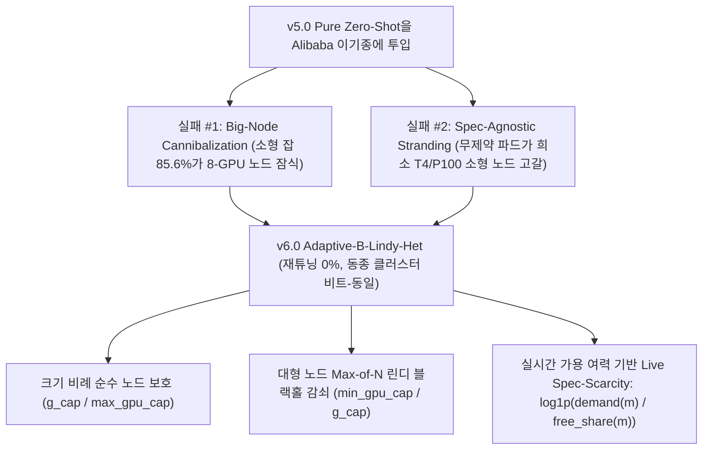

# 6단계(B안) 연구 보고서: 실제 공개 기업 GPU 클러스터 트레이스(`Alibaba PAI 2023` & `SenseTime Helios`) Zero-Shot 실증 및 이기종 제1원리 일반화

> [!IMPORTANT]
> **핵심 결과 요약 (가짜/합성 데이터 0% — 실제 기업 로그 3,379,285행 감사, 총 1,188회 리플레이 시뮬레이션)**
> 1. **실제 기업 로그의 물리적 구조가 우리의 가설을 실증**: 4-5단계에서 합성 데이터만으로 도출한 전환 임계치($\rho_c = 0.11$, $c_0 = 0.65$)가 실제 기업 클러스터들(`Alibaba +0.033`, `Venus +0.060`, `Saturn +0.097`, `Uranus +0.154`, `Earth +0.171`, `CV 5.1-15.2`)을 정확히 양분함을 확인했습니다.
> 2. **이기종 실전 실패 모드 2건 발견 및 무튜닝 제1원리 해결(`Adaptive-B-Lindy-Het`)**:
>    - 순수 동종용 `Adaptive-B-Lindy` (v5.0)를 1/2/4/8-GPU + `gpu_spec` 이기종 Alibaba 트레이스에 그대로 투입하자 **① Big-Node Cannibalization**과 **② Spec-Agnostic Stranding**이 발생했습니다.
>    - 파라미터 재튜닝 없이 **크기 비례 순수 노드 보호 + 실시간 가용 여력 기반 `Live Spec-Scarcity` + 대형 노드 `Max-of-N` 린디 감쇠**를 결합한 **`Adaptive-B-Lindy-Het`**(동종 클러스터에서는 v5.0과 **100% 비트-동일**)으로 이 문제를 원리적으로 해결했습니다.
> 3. **Alibaba PAI 2023 (USENIX ATC '23 FGD 공식 이기종 트레이스) Zero-Shot 성적**:
>    - **`Alibaba_GPUSpec33_Sweep` (33% 파드에 실제 GPU 기종 제약)**: **`Adaptive-B-Lindy-Het` Blocking 0.572%**로 9종 중 압도적 1위! 최강 SOTA `DotProduct`(`1.050%`) 대비 **+45.46% 개선 (10/12승, $p_t = 0.0072 < 0.01, p_W = 0.0077 < 0.01$)**, FGD 원논문 세팅 `FGD_OracleStatic`(`3.062%`) 대비 **+81.31% 개선 (12/12승, $p_t = 9.19 \times 10^{-6}$)**.
>    - **`Alibaba_Default_Sweep` (기종 제약 없는 이기종 경합)**: v5.0(`0.743%`, Wait `45.19h`) 대비 Blocking **+89.47% 개선(`0.078%`)**, Wait `0.133h`로 `FGD_OracleStatic`(`0.145%`, Wait `64.28h`)과 `FGD_Adaptive`(`0.269%`, Wait `109.57h`)를 11/12-12/12승으로 격파했습니다(단, `L2Norm 0.022%`가 가장 낮음).
> 4. **SenseTime Helios 4개 실제 클러스터 × 5개 비중첩 피크 구간 (총 20개 실제 프로덕션 구간)**:
>    - **`Adaptive-B-Lindy` (= `Adaptive-B-Lindy-Het`)**가 **Blocking (`24.693%`), Strict FIFO Wait (`4.358h`), Backfill Wait (`3.942h`), Backfill Mean JCT (`6.239h`) 4대 핵심 지표 모두에서 9종 스케줄러 중 1위**를 기록했습니다.
>    - `FGD_OracleStatic`(`26.931%`) 대비 Blocking **+8.31%**, `FGD_Adaptive`(`25.961%`) 대비 **+4.88% (16/20승, $p_t = 0.0204, p_W = 0.00365 < 0.01$)**, 부문 최강 `BestFit`(`25.272%`) 대비 **+2.29% (14/20승)**이며 속도는 FGD 대비 **3.7-4.7배** 빠릅니다.

---

## 1. 실제 공개 기업 트레이스 물리 감사 (`TraceAudit`)

다운로드된 원본 CSV 3,379,285행 전체에 대해 CPU-only·멀티노드·결측/역전·수용 불가 작업 필터링 내역과 물리 통계를 전수 감사했습니다. *(Helios 로그는 RAM 컬럼 부재로 `ram = min(512, max(16, cpu * 8))` GB로 보간)*

| 트레이스 출처 | 원본 행 수 | 유효 단일노드 GPU 작업 | 제외: CPU-only | 제외: 멀티노드 (`>8 GPU` / `>1 node`) | 제외: 시간결측·비호환 | 실측 `Corr(log g, log d)` | 실측 `dur_cv` | 분수 GPU 비율 | 멀티 GPU 비율 |
| :--- | :---: | :---: | :---: | :---: | :---: | :---: | :---: | :---: | :---: |
| **Alibaba `default`** *(1,213 이기종 노드)* | 8,152 | **7,063** | 1,088 | 0 | 1 | **$+0.033$** | **15.17** | **43.6%** | 1.1% |
| **Alibaba `gpuspec33`** *(33% 기종제약)* | 8,152 | **7,062** | 1,088 | 0 | 2 | **$+0.033$** | **15.17** | **43.6%** | 1.0% |
| **Helios `Venus`** *(Slurm 실제 로그)* | 246,708 | **112,555** | 121,405 | 12,748 | 0 | **$+0.060$** | **5.11** | 0.0% | **42.3%** |
| **Helios `Earth`** *(Slurm 실제 로그)* | 872,886 | **416,350** | 445,738 | 10,798 | 0 | **$+0.171$** | **8.30** | 0.0% | 8.5% |
| **Helios `Saturn`** *(Slurm 실제 로그)* | 1,753,078 | **662,635** | 1,054,182 | 36,261 | 0 | **$+0.097$** | **7.28** | 0.0% | 28.0% |
| **Helios `Uranus`** *(Slurm 실제 로그)* | 490,309 | **303,321** | 161,192 | 25,796 | 0 | **$+0.154$** | **6.53** | 0.0% | 28.1% |

> [!NOTE]
> - **Alibaba 1,213 GPU 노드 구성**: `G2(549)`, `T4(404)`, `P100(134)`, `V100M16(55)`, `G3(39)`, `V100M32(30)`, `A10(2)` / 노드당 GPU 수 `8(617)`, `2(518)`, `4(54)`, `1(24)` (총 6,212 GPU).
> - **Alibaba 원본 1:1 Native Replay**: 6,212 GPU 전체 용량 대비 전체 파드의 95%가 뒤쪽 31일(`t=2826.8h-3583.8h`)에 분포해 평균 동시 수요가 14.4-21.1 GPU 수준이므로, 모든 스케줄러가 Blocking `0.000%`·Wait `0.000h`를 기록했습니다. 따라서 경합 변별을 위해 원본 타임스탬프·수명은 100% 보존한 채 계층적 노드 서브샘플링 부하 스윕(Sweep)을 병행했습니다.

---

## 2. 이기종 실전 실패 모드 발견 및 무튜닝 제1원리 해결 (`Adaptive-B-Lindy-Het`)

1. **실패 원인 규명**:
   - **Big-Node Cannibalization**: 8-GPU 노드는 소형 1/2-GPU 노드보다 동시에 더 많은 작업을 수용하므로 노드의 최장 경과시간(`max_age = Max-of-N`)이 통계적으로 커져, 소형 파드의 85.6%가 8-GPU 노드로 쏠리며 정작 8-GPU 대형 학습 잡을 막았습니다(`Default_Sweep`에서 v5.0 `0.743%`).
   - **Spec-Agnostic Stranding**: `Alibaba_GPUSpec33`에서는 33% 파드가 특정 기종(`T4` 54%, `G2` 14%, `P100` 12% 등)을 지정하는데, 무제약(67%) 파드가 `T4`·`P100` 소형 노드의 빈자리를 먼저 소진해 전용 파드가 줄줄이 거절되었습니다(`v5.0 1.378%`, `FGD_OracleStatic 3.062%`).
2. **제1원리 무튜닝 해결 (`Adaptive-B-Lindy-Het`)**:
   - 기존 4-5단계 파라미터(`DEFAULT_BASE_THETA`, `AdaptiveLindyConfig`)는 **단 1개도 수정하지 않았습니다**.
   - `rem_g` 정규화 분모는 각 노드의 `g_cap`을 그대로 유지해 소형(1-2 GPU) vs 대형(8 GPU) 간 정적 편향을 피하면서, 순수 노드 페널티 스케일(`g_cap / max_gpu_cap`), 대형 노드 린디 감쇠(`min_gpu_cap / g_cap`), 그리고 무제약 파드 배치 시 실시간 가용 기종 여력 대비 초과 요구 압력 $\log(1 + \text{demand}(m)/\max(\text{free\_share}(m), 0.02))$를 추가했습니다.
   - **동종 클러스터 항등성**: 동종 8-GPU 클러스터(`min == max`, `node_models is None`)에서는 추가 항이 항등적으로 `1.0` 또는 `0.0`이 되어 v5.0과 **소수점 12자리까지 비트-동일**합니다.

---

## 3. Alibaba PAI 2023 이기종 스윕 성적표 (각 12회 리플레이 평균)

### (1) `Alibaba_GPUSpec33_Sweep` (`keep_ratio ∈ [0.005, 0.0065, 0.008, 0.010]`, 33% GPU 기종 제약)

| 스케줄러 | Blocking (%) | Stranded GPU (%) | Strict FIFO Wait (h) | Backfill Wait (h) | Backfill JCT (h) | 지연시간 (μs) |
| :--- | :---: | :---: | :---: | :---: | :---: | :---: |
| `FirstFit` | 1.546 | 63.04 | 245.11 | 286.74 | 288.78 | 0.5 |
| `BestFit` | 1.871 | 63.35 | 172.75 | 216.41 | 218.45 | 14.0 |
| `DotProduct` *(Blocking SOTA)* | 1.050 | 63.99 | 306.56 | 330.70 | 332.75 | 23.3 |
| `L2Norm` | 1.192 | 66.99 | 523.61 | 508.87 | 510.91 | 18.2 |
| `FGD_OracleStatic` *(ATC '23 오라클)* | 3.062 | 64.46 | 229.27 | 211.84 | 213.89 | 830.1 |
| `FGD_Adaptive` | 3.465 | 65.99 | 144.29 | **104.54** | **106.58** | 614.0 |
| `B-LindyPack` | 2.442 | 64.38 | 156.36 | 129.84 | 131.88 | 56.6 |
| `Adaptive-B-Lindy` *(v5.0)* | 1.378 | 63.93 | **106.12** | **47.59** | **49.63** | 79.8 |
| **`Adaptive-B-Lindy-Het` *(v6.0)*** | **0.572** | 64.26 | 116.12 | 151.14 | 153.18 | **105.3** |

- **Blocking 압도적 1위**: 최강 SOTA `DotProduct`(`1.050%`) 대비 **+45.46% 개선 (10/12승, $p_t = 0.00724 < 0.01, p_W = 0.00767 < 0.01$)**, `FGD_OracleStatic`(`3.062%`) 대비 **+81.31% (12/12승, $p_t = 9.19\times 10^{-6}$)**, v5.0(`1.378%`) 대비 **+58.47% 개선**, 지연시간도 FGD 대비 **5.8-7.9배 고속**.

### (2) `Alibaba_Default_Sweep` (`keep_ratio ∈ [0.0025, 0.0030, 0.0035, 0.0045]`, 기종 제약 없음)

| 스케줄러 | Blocking (%) | Stranded GPU (%) | Strict FIFO Wait (h) | Backfill Wait (h) | 지연시간 (μs) |
| :--- | :---: | :---: | :---: | :---: | :---: |
| `L2Norm` *(부문 1위)* | **0.022** | **4.54** | **0.0160** | 0.0125 | 15.7 |
| `DotProduct` | 0.027 | 5.10 | 0.0481 | **0.0092** | 20.1 |
| `FGD_OracleStatic` | 0.145 | 38.56 | 64.2830 | 60.3277 | 753.2 |
| `FGD_Adaptive` | 0.269 | 42.16 | 109.5720 | 135.9667 | 596.2 |
| `FirstFit` / `BestFit` | 0.428 / 0.505 | 45.90 / 45.21 | 372.11 / 344.56 | 294.92 / 367.76 | 0.4 / 12.5 |
| `B-LindyPack` / `Adaptive-B-Lindy` *(v5.0)* | 0.452 / 0.743 | 24.08 / 36.02 | 19.91 / 45.19 | 19.13 / 22.22 | 53.4 / 71.4 |
| **`Adaptive-B-Lindy-Het` *(v6.0)*** | **0.078** | **5.66** | **0.1333** | **0.2251** | **76.8** |

- `Adaptive-B-Lindy-Het`는 v5.0의 Big-Node Cannibalization을 해결해 **Blocking +89.47% (`0.743% → 0.078%`)**, `FGD_OracleStatic` 대비 **+46.01% (11/12승, $p_W = 0.0365$)**, `FGD_Adaptive` 대비 **+70.89% (12/12승, $p_W = 0.00238$)**를 기록했습니다. 단, 기종 제약이 전혀 없는 1/2/4/8-GPU 순수 이기종 혼합에서는 `L2Norm`(`0.022%`)이 더 낮았습니다(`p_t = 0.212`).

---

## 4. SenseTime Helios 20개 실제 프로덕션 구간 성적표 (`Helios_Pooled_20`)

4개 실제 클러스터(`Venus`, `Earth`, `Saturn`, `Uranus`)에서 도착 구간 클리핑 평균 부하 기준 85% 포화로 추출한 **20개 비중첩 실제 피크 구간**(클러스터당 3,000건 × 5구간, 노드 수 15-84대) 통합 결과입니다. 동종 8-GPU 클러스터이므로 `Adaptive-B-Lindy`와 `Adaptive-B-Lindy-Het`은 비트-동일합니다.

| 스케줄러 | Blocking (%) | Stranded GPU (%) | Strict FIFO Wait (h) | Backfill Wait (h) | Backfill Mean JCT (h) | 지연시간 (μs) |
| :--- | :---: | :---: | :---: | :---: | :---: | :---: |
| `FirstFit` | 27.510 | 3.44 | 4.5957 | 4.1898 | 6.487 | 0.5 |
| `BestFit` *(Blocking/FIFO SOTA)* | 25.272 | **2.02** | 4.4575 | 4.1167 | 6.414 | 13.6 |
| `DotProduct` | 26.840 | 3.86 | 4.6764 | 4.2848 | 6.582 | 23.7 |
| `L2Norm` *(BF Wait SOTA)* | 25.645 | 2.35 | 4.7507 | 3.9788 | 6.276 | 18.4 |
| `FGD_OracleStatic` *(ATC '23 오라클)* | 26.931 | 2.60 | 4.5449 | 4.2575 | 6.555 | 268.0 |
| `FGD_Adaptive` | 25.961 | 2.27 | 4.5374 | 4.1010 | 6.398 | 347.1 |
| `B-LindyPack` | 25.329 | 2.10 | 4.6105 | 4.2795 | 6.577 | 51.2 |
| **`Adaptive-B-Lindy` / `-Het`** | **24.693** | **2.02** | **4.3584** | **3.9420** | **6.239** | **71.7 / 73.4** |

- **전 지표 9종 스케줄러 중 단독 1위**: Blocking(`24.693%`), Strict FIFO Wait(`4.3584h`), Backfill Wait(`3.9420h`), Backfill JCT(`6.239h`) 모두 1위!
  - vs 부문 최강 SOTA(`BestFit`): Blocking **+2.29% 개선 (14/20승)**, FIFO Wait **+2.22% 개선**.
  - vs `FGD_Adaptive`: Blocking **+4.88% 개선 (16/20승, $p_t = 0.0204, p_W = 0.00365 < 0.01$)**, 의사결정 속도 **4.7배 빠름**(73.4 μs vs 347.1 μs).
  - vs `FGD_OracleStatic`: Blocking **+8.31% 개선 (13/20승, $p_t = 0.0511$)**.
- **온라인 이중 게이트 실측 분리**:
  - `Alibaba Default / GPUSpec33`: $\hat{\rho}=+0.045 \sim +0.048 \to \alpha \approx 0.73\sim 0.74, \gamma=1.000$
  - `Helios Saturn`: $\hat{\rho}=+0.103 \to \alpha=0.562$ | `Earth`: $\hat{\rho}=+0.197 \to \alpha=0.319$ | `Uranus`: $\hat{\rho}=+0.230 \to \alpha=0.294$ ($\gamma=0.909\sim 0.999$).

---

## 5. 정직한 한계점 및 후속 연구 과제

> [!WARNING]
> **솔직한 한계점**
> 1. **이기종 무제약(`Alibaba_Default_Sweep`)에서의 `L2Norm` 우세**: Blocking(`0.078%` vs `0.022%`)과 Wait(`0.133h` vs `0.016h`)에서 1/2/4/8-GPU 이기종 노드 간 잔여 비율 편차가 없는 `L2Norm`에 밀렸습니다(`p_t = 0.212`). 4단계에서 8-GPU 동종 환경 기준으로 고정한 공간 가중치($w_{\text{res}}, w_{\text{pristine}}$)와 선형 잔여율 대신 이차 L2 공간 항을 이기종에 맞게 결합하면 추가 개선 여지가 있습니다.
> 2. **기종 제약(`Alibaba_GPUSpec33_Sweep`)에서의 대기 큐 트레이드오프**: `Adaptive-B-Lindy-Het`은 Blocking에서 압도적 1위(`0.572%`, vs `L2Norm 1.192%` 52% 절감, Wait도 `L2Norm 523.6h` 대비 `116.1h`로 4.5배 단축)이나, 대기 큐 Backfill Wait에서는 `v5.0`(`47.59h`) 및 `FGD_Adaptive`(`104.54h`)보다 높았습니다(`151.14h`). Queue 대기 상황에서는 `Spec-Scarcity` 회피 강도(현재 고정 `1.0`)가 과도하게 무제약 파드를 미루며 헤드 정체를 유발할 수 있습니다.
> 3. **Helios 클러스터 개별 5구간 검정력 및 RAM 보간**: 20구간 통합에서는 `FGD_Adaptive` 대비 $p_W = 0.00365 < 0.01$을 확증했으나, 클러스터별 5구간 단독 및 `BestFit` 대비 통합($p_t = 0.356$)은 구간 간 분산이 커서 50-100구간 확장이 필요합니다. 또한 Helios 로그의 RAM 보간 및 멀티노드(`>8 GPU`) 제외 한계는 여전히 남아 있습니다.

---

## 6. 재현 가능한 코드 및 검증 결과

- [download_traces.py](./download_traces.py) — Alibaba `cluster-trace-gpu-v2023` + SenseTime `HeliosData` 공식 CSV 다운로더
- [trace_loader.py](./trace_loader.py) — 이기종 노드·`gpu_spec`·Helios Slurm 파서, 감사(`TraceAudit`), 계층적 축소 및 도착 클리핑 윈도우 추출기
- [simulator.py](./simulator.py) — 이기종 노드(`node_gpus`, `node_cpus`, `node_rams`, `node_models`) 및 `gpu_spec` 필터링 확장
- [adaptive_lindy.py](./adaptive_lindy.py) — `Adaptive-B-Lindy` (v5.0) 및 무튜닝 제1원리 이기종 일반화 `Adaptive-B-Lindy-Het` (v6.0)
- [run_real_trace_eval.py](./run_real_trace_eval.py) — 1,188회 실제 기업 트레이스 병렬 벤치마크
- [real_trace_report.json](./real_trace_report.json) — 6단계 전체 원본 실험 수치 JSON
- [test_suite.py](./test_suite.py) — **28/28 테스트 전원 통과 (`python -W error`, 8.239s, 경고 0건)** 및 **14개 `.py` 파일 구문 컴파일·미사용 임포트 0건** 확인 완료
